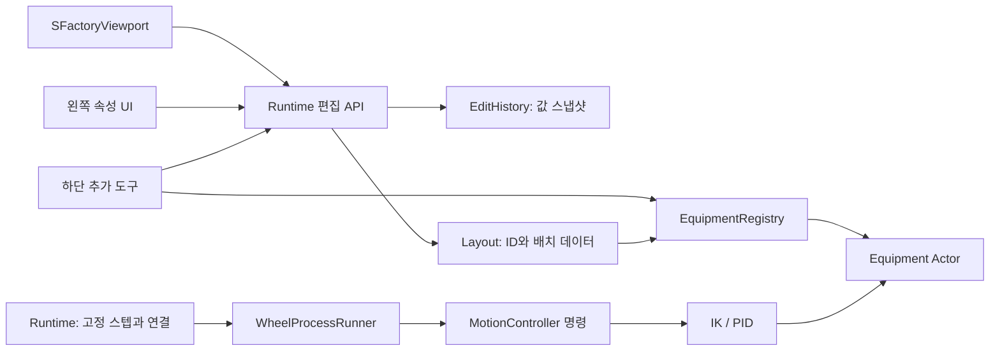

# 공장 편집기·공통 설비·팀 통합 규약

수정일: 2026-10-28

## 우선 적용 규약: 독립 기능 설비와 팀 협업

이 절은 앞으로 구현할 공통 계약이다. 아래의 과거 구현 설명과 충돌하면 이 절을 개발 목표로 적용하되, **문서 갱신만으로 해당 기능이 구현된 것은 아니다.** C++만 사용하고 UI는 한국어 우선, 표시 이름은 `한국어 (English)`로 한다.

목표는 팀원이 만든 휠 작업 로봇·도어 작업 로봇 등을 사용자가 하단 목록에서 추가하고, 위치·방향·작업 대상을 편집하며, 삭제·복원·저장할 수 있게 만드는 것이다. 팀원은 설비 동작을 개발하고 공장 담당자는 등록·배치·작업 연결을 담당한다. 로봇을 놓는 것만으로 부품 종류나 조립 순서를 자동 추론하지 않는다.

### A. 현재 상태와 다음 구현의 경계

| 항목 | 현재 | 다음 구현 계약 |
|---|---|---|
| 설비 등록 | Definition/Registry 및 ExtraEquipment 존재 | 기능 로봇을 어댑터로 등록하고 지원 작업을 명시 |
| 팀원 휠·도어 기능 | 고정 조립 라인 단위로 연결 | 로봇 인스턴스별 생성·연결·실행·해제 |
| 작업 대상 | 기존 단일 휠 job 또는 시험 셀 Actor 참조 | 설비/제품/부품/포트 ID로 명시적 연결 |
| 작업 UI | 기존 작업 전용 표시 | 지원 작업, 대상 선택, 설정, 상태·실패 사유 공통 표시 |
| 저장 | v2 단일 job, 통합 시험은 공장·구역만 JSON 저장 | 설비별 설정·연결·작업 목록을 새 버전에서 저장 |
| 센서·물리 | 일부 가상 센서, IK/PID, 단순 운반 모델 | 측정값·물리 상태 분리, 단위·가정·검증 범위 명시 |

이하의 포트 목록, 지원 작업 목록, 설정 메타데이터, 다중 작업 및 자원 예약은 **설계 계약**이며 현재 존재하는 C++ 필드/API 이름을 뜻하지 않는다. 기존 클래스에 필요한 최소 확장부터 적용한다. 새 C++ 설비의 최초 등록에는 빌드·등록 및 필요 시 에디터 재시작이 필요하다. 등록된 종류의 인스턴스 추가·삭제는 Play 편집 모드에서 가능하도록 한다. 실행 중 새 C++ 모듈을 동적으로 설치하는 기능은 범위에 포함하지 않는다.

### B. 책임과 클래스 경계

| 책임 | 구현 위치/방침 |
|---|---|
| 종류와 기본 설정 | 기존 UFactoryEquipmentDefinition/Registry 확장. TypeId, 표시명, 클래스, 버전, 지원 작업, 설정 범위 제공 |
| 설비 인스턴스 | AFactoryEquipment 계열의 네이티브 어댑터. 배치 기준점·외형·포트·컨트롤러·센서 구성 소유 |
| 로봇 제어 | 기존 팀원 ARobotArm/IK/PID를 어댑터로 재사용. 동일 알고리즘 복사 금지 |
| 센서 | 설비별 측정 상태·갱신 주기·고장 상태 관리. 공정에는 측정 인터페이스 제공 |
| 한 작업의 순서 | UFactoryProcessRunner 계약을 기반으로 인스턴스별 작업 실행기 구성 |
| 공정 간 연결 | 공장 실행 계층이 선행 조건·자원 충돌·부품 인계를 조정. 로봇 내부에서 전체 라인 순서 결정 금지 |
| 편집·저장·화면 | 공통 Runtime/편집 계층. 설비 자체가 키 입력·카메라·전용 GameMode를 소유하지 않음 |

Registry/Factory는 종류별 생성을, Adapter는 기존 팀원 코드의 연결을, 구성과 Strategy는 제어/작업 교체를, 상태 머신은 작업 진행을 담당한다. Undo는 기존 값 스냅샷 방식을 유지한다. 모든 설비를 거대한 로봇 부모 클래스에 넣거나 설비마다 Runtime/UI 조건문을 복제하지 않는다.

현재 AWheelAssemblyCell은 로봇 두 대와 휠 네 개 작업을 묶고 있으므로 그대로 복제하는 것만으로 독립 로봇 등록을 완료했다고 보지 않는다. 로봇 한 대의 작업과 여러 로봇을 조정하는 순서를 분리한다. 다중 로봇 협업이 필요한 작업은 참여 설비 ID 목록을 가진 별도 조정 작업으로 표현한다. ADoorAssemblyCell도 고정된 문/차체 참조를 외부에서 주입받게 만든다.

### C. 식별자·설정·작업 대상

- **TypeId**: 설비 종류의 안정적인 ID. 표시명 변경과 무관하며 다른 종류에 재사용하지 않는다.
- **InstanceId**: 배치된 설비마다 고유한 ID. 복제 시 새 ID, 삭제 Undo 시 기존 ID를 복원한다.
- **OperationType / OperationInstanceId**: 지원 작업의 종류와 배치된 개별 작업을 구분한다.
- **ProductId / PartId / PortId**: 대상 차량, 해당 차량의 부품, 설비/제품에 속한 기준점을 구분한다. 포트 참조는 소유 ID와 포트 ID를 함께 사용한다.
- Actor 포인터는 실행 중 해석한 캐시로만 사용한다. 저장/Undo에는 ID와 값만 기록한다. Actor 이름·메시 이름·태그 검색 순서로 대상을 선택하지 않는다.
- 같은 종류의 두 로봇이 제어기, PID 적분 상태, 센서, 작업 단계, 명령, 고장 상태를 공유하지 않는다. 공유 가능한 것은 읽기 전용 정의와 에셋이다.

팀원은 설정마다 내부 키, 한국어 이름, 자료형, 단위, 기본값, 허용 범위, 수정 가능 시점, 도움말을 제공한다. 예: 속도 제한, 허용 하중, 정렬 공차, 센서 주기. 공통 Inspector 생성 기능은 후속 구현이며 임의 값을 저장만 하고 실제 제어에는 적용하지 않는 설정을 노출하지 않는다.

사용자는 로봇의 지원 작업 중 하나를 선택하고 공급 위치, 차체 정지 위치, 제품/부품, 장착 또는 인계 기준점을 연결한다. 동일 프로토콜의 새 로봇은 정의·어댑터 등록으로 통합한다. 새로운 물류/가공 방식은 작업 실행기와 공통 연결·결과 스키마 확장이 필요할 수 있다.

| 작업 예 | 필요한 연결 | 완료 조건의 구분 |
|---|---|---|
| 휠 작업 (Wheel Assembly) | 로봇, 툴, 휠 공급 포트, 차량 정지대, FL/FR/RL/RR 대상 휠·허브 | 운반/정렬 완료와 체결 품질 합격을 별도 결과로 기록 |
| 도어 작업 (Door Handling) | 로봇, 그리퍼, 문 공급 포트, 대상 차량·문, 인계 지그/기준점 | 근접 운반·인계 완료가 기본. 체결 모델이 없다면 체결 완료라고 표시하지 않음 |
| 컨베이어 이송 (Conveyor Transfer) | 송신 출구, 수신 입구, 운반 제품, 수신 준비 신호 | 제품 도착·안정 및 수신 측 인수 확인 |

현재 팀원의 시간 기반 체결/부착 기능은 기능 통합 시험으로 재사용할 수 있지만 실제 볼트 체결 물리나 합격 판정으로 간주하지 않는다.

### D. 좌표·모델 교체·배치 검증

설비 바닥 기준 FunctionalRoot와 외형 VisualRoot를 분리한다. TCP, 공급점, 입출구, 장착/인계점은 이름이 있는 로컬 자세로 정의하고 소유 설비/제품의 현재 월드 자세에서 계산한다. 기존 월드 목표 캐시는 이동·회전·모델/설정 변경 후 폐기한다. 중첩된 툴·제품 좌표계까지 적용한다.

공급대나 차체도 이동할 수 있으므로 로봇만 옮겼을 때와 같은 검증 경로를 사용한다. 기존 하드코딩 좌표·후방 휠 관절 목표를 임의 배치에 그대로 재사용하지 않는다. IK 성공은 충돌 없는 전체 경로의 증거가 아니다. 도달 범위, 관절 제한, 지원 툴/하중, 포트 호환, 공장 경계와 구현된 충돌 검사 범위를 검증한다. 미연결·도달 불가이면 실행을 막고 한국어로 원인을 표시한다. 미구현 검사는 '미검증'으로 표시한다.

외형만 교체할 때는 기능 기준점과 설정 의미를 유지한다. 링크 길이·TCP·관절축·질량/관성이 바뀌는 로봇 모델은 새 기구학/물리 설정과 회귀 검증이 필요하다. 메시 스케일만으로 동작 범위를 늘리지 않는다.

### E. 실행 생명주기·자원 소유권

기존 Validate/Start/Stop/Reset/Step 계약을 유지하고 공통 상태·결과를 확장한다. 의미상 준비, 실행, 대기, 정지 중, 정지, 완료, 고장을 구분한다. 이는 신규 enum이 이미 존재한다는 뜻이 아니다.

1. Validate는 연결·설정·실행 가능성을 검사하며 Actor나 부품을 움직이지 않는다.
2. Start 수락과 작업 완료를 구분한다. 준비 조건/센서 유효성 확인 후 작업을 시작한다.
3. Runtime만 고정 스텝을 공급한다. 장치 Actor Tick과 Runner에서 같은 제어/물리를 이중 갱신하지 않는다.
4. Stop은 새 동작을 막고 정의된 감속·보유 정책을 수행한다. 정지 중에도 필요한 물리·센서 갱신을 계속한다. 정지 요청 즉시 속도가 0이 됐다고 가정하지 않는다.
5. Reset은 편집으로 돌아가기 위한 시뮬레이션 초기화다. 현장 안전 복귀 동작과 구분하며 현재 배치의 초기 조건으로 복원한다.
6. 완료/취소/실패는 요청당 한 번 보고한다. Epoch/Sequence로 이전 실행·삭제된 설비의 늦은 응답을 무시한다. Reset/재구성 시 Epoch를 갱신한다.

작업 컨텍스트에는 실행 대상, 연결된 포트, 설정, 요청 ID를 전달한다. 공통 결과에는 작업/설비/제품 ID, 시뮬레이션 시각, 상태, 실패 코드·한국어 이유, 단위가 있는 측정값, 적용 물리 모델 수준을 포함한다. UI는 내부 상태 머신을 직접 수정하지 않는다.

부품을 움직이는 제어 소유자는 한 곳이어야 한다. 로봇·그리퍼·지그·차체 장착점에 대한 예약과 실제 부품 보유를 구분한다. 인계는 수신 준비 및 인수 확인 뒤 송신 측이 제어를 해제한다. 두 로봇이 같은 부품을 잡거나 동일 지그를 동시에 점유하려 하면 대기/실패로 처리한다. Stop/고장 때 보유 중인 부품을 자동으로 해제하거나 사라지게 만들지 않는다. 양손 협업은 하나의 조정 작업과 물리 구속 정책으로 별도 정의한다.

### F. 물리량·센서·재현성

[물리 설계 원칙](PHYSICS_DESIGN_PRINCIPLES.md)을 함께 따른다. 신규 역학 계산은 SI(m, kg, s, N, N·m, Pa, rad)를 기본으로 하며 Unreal Transform의 cm와 화면의 mm/deg는 경계에서 변환한다. **기존 Factory 제어 API의 deg 계열과 팀원 로봇의 rad 계열은 어댑터에서 명시적으로 변환한다.** 기존 API를 묵시적으로 rad로 바꾸지 않는다. PID 출력이 위치/속도/가속도/토크 중 무엇인지 기록하고 서로 다른 모델의 게인을 그대로 복사하지 않는다.

- 질량·무게중심·관성, 속도/가속도 제한, 툴 하중, 마찰·구속 등 실제 계산에 사용하는 항목과 미구현 항목을 설비별로 명시한다. 수치의 출처·가정·유효 범위를 남긴다.
- IK는 목표 관절 자세를 구한다. PID와 구동기/플랜트 모델이 시간에 따른 응답을 계산한다. IK 해를 매 프레임 즉시 적용하는 것을 물리 제어로 설명하지 않는다.
- Attach/SetTransform만으로 파지력, 미끄러짐, 컨베이어 마찰, 체결 토크를 검증했다고 표시하지 않는다. 단순 모델은 기능 시험 단계임을 밝힌다.
- 실제 상태와 센서 측정값을 분리한다. 측정값에는 단위, 표본 시각, 유효 여부를 제공하며 주기·지연·노이즈·고장 조건을 정의한다. 공정 인터록은 측정값을 사용하고 기준 실제 상태는 검증용으로 별도 기록한다.
- 갱신 순서는 공통 시계에서 명령/제어 → 플랜트 진행 → 시각에 맞는 센서 표본 → 공정 판정으로 고정한다. 판정에 따른 다음 명령은 다음 스텝에 적용한다. 세부 구현은 이 순서를 만족하도록 기존 루프와 조정한다.
- 타임아웃은 시뮬레이션 시간, 난수는 기록된 시드를 사용한다. 프레임률에 따라 센서나 PID를 중복 갱신하지 않는다. 같은 모델/설정/시드의 허용 오차 내 재현성을 검사한다.

### G. 편집·삭제·Undo·저장 계약

초기 통합은 실행 중 구조 편집을 잠근다. Stop만으로 바로 삭제하지 않고 Reset으로 편집 상태에 복귀한 뒤 추가/삭제/이동/연결 변경을 허용한다. 실행 중 재배치는 별도 설계 전까지 지원하지 않는다.

삭제는 소유한 보조 Actor·컨트롤러·센서·구독을 정리하고 관련 작업 연결과 예약을 한 트랜잭션으로 정리한다. 외부 소유 차량/부품을 함께 삭제하지 않는다. 삭제 후 미완성 작업은 실행 불가로 표시하고 임의의 다른 로봇으로 재연결하지 않는다. Undo는 원래 ID, 설정, 연결, 순서를 복원한 후 객체를 재생성·재바인딩한다. 드래그 한 번은 기록 한 건이다.

저장 확장에는 스키마 버전, 정의 버전, 인스턴스 ID/TypeId/자세/설정, 작업 목록/순서/연결, 제품 시작 조건을 포함한다. 런타임 포인터·진행 중 PID/명령/센서 상태는 저장하지 않는다. 작업 중간 재개는 별도 범위다. 미등록 TypeId·깨진 참조·미지원 버전은 현재 배치를 유지하고 로드를 거절한다.

현재 v2는 그대로 둔다. 새 스키마 구현 시 버전을 올리고 기존 단일 job의 변환 규칙과 예제/검사를 함께 제공한다. **현재 고정 통합 셀을 저장·불러오기만 해서 독립 설비로 자동 전환할 수는 없다.**

편집 조작 목표: W는 카메라 기준 전진, S는 후진, A/D는 좌우 이동, 우클릭 위 드래그는 위쪽 보기, 아래 드래그는 아래쪽 보기, 휠클릭 드래그는 평행 이동이다. 바닥 편집용 이동축은 카메라 전방의 수평 투영을 기준으로 하고 수직에 가까우면 마지막 유효 수평 방향을 유지한다. 현재 보고된 W/S 및 상하 회전 반전은 **수정 대기**이며 이 문서 변경으로 수정된 것은 아니다.

### H. 팀원이 전달할 최소 묶음과 통합 순서

팀원은 다음을 함께 전달한다.

1. 네이티브 설비/어댑터·제어·센서·작업 코드, 등록 정의와 필요한 에셋 및 라이선스.
2. 지원 작업과 명령의 의미, 로컬 기준점/포트, 설정 표, 단위·모델 가정·미지원 기능.
3. 명시적 대상 연결 예제와 팀원 전용 시험 맵. 공용 factory_p1 맵 수정은 공장 담당자가 맡는다.
4. 정상/실패 시나리오, 정지·초기화 정책, 검사 실행법 및 결과.

공장 담당자는 정의/어댑터 등록 → 독립 한 대의 대상 연결 → 두 대 동시 배치 → 편집/저장 통합 → 공정 순서 연결 순으로 검증한다. 휠 기능을 먼저 이 절의 기준으로 완성하고 같은 계약으로 도어 기능을 통합한다. 기존 IK/PID와 센서는 재사용하되 맵 고정 참조·전역 검색·고정 좌표 의존부터 제거한다.

| 수용 검사 | 합격 기준 |
|---|---|
| 독립 두 대 | 한 대 실행/고장이 다른 인스턴스 상태를 변경하지 않음 |
| 이동·90° 회전 | 새 로컬 기준에서 작업하거나 명확한 도달 불가 사유를 보고 |
| 대상 선택 | 휠/도어 좌우·앞뒤 및 차량 ID에 맞는 부품만 조작 |
| 참조 누락·경쟁 | 미연결 실행 차단, 동일 부품 이중 제어 방지 |
| 삭제·Undo/Redo | 소유 객체 정리, ID·설정·연결 복원, 늦은 응답 무시 |
| 저장·새 실행 | 동일 배치/설정/연결 복원, 잘못된 파일은 기존 상태 보존 |
| Stop·Reset | 정의된 정지/보유 정책, 현재 배치 초기 조건 복원 |
| 센서 고장 | 끊김/오래된 측정값에 따른 대기·고장, 실제 상태와 측정 오류 구분 |
| 외형 교체 | 기준점·제어 유지, 기구학 변경은 별도 검증 |
| 공통 UI | 하단 추가, 왼쪽 속성/대상/실행, 한국어 상태·실패 사유 |

위 표는 신규 통합의 수용 기준이며 아래의 과거 12/50/8개 검사 통과로 충족됐다고 간주하지 않는다.

---
## 2026-10-28: 팀원 조립 라인 통합 시험

`factory_p1`에 고정 배치 테스트 셀을 추가한다. `AFactoryRuntime::bUseAssemblyIntegration`과 명시적 `TestAssemblyLine` 참조가 모드를 결정한다. `UFactoryAssemblyProcessRunner`는 기존 `UFactoryProcessRunner` 계약으로 Start/Stop/Reset/Step을 연결한다. 월드에서 첫 라인을 검색하지 않으며 팀원의 IK/PID·센서·작업 상태 머신을 복제 구현하지 않는다.

- `AutonomousAssemblyLine`의 Actor를 일괄 복제하고 내부 참조와 차량 모듈 42개의 부착 관계를 보존한다. 원본 맵은 변경하지 않는다.
- 라인 Actor 자체 Tick은 꺼두고 공장 Runtime의 1/120초 시계만 사용한다. 준비 중 센서 갱신과 정지/고장 후 반입 감속도 이 시계에서 계속 처리한다.
- 기존 GameMode/카메라/입력은 이식하지 않는다. 공장 Slate UI에서 명령·결과·센서를 표시한다.
- 구역·공장 편집과 고정 테스트 셀의 설비 배치를 구분한다. 이 모드는 설비 카탈로그 등록/자유 배치/복제를 완료한 것이 아니다. 추가 도구는 구역으로 제한하며 예약 작업 영역이 공장 밖이면 시작을 차단한다.
- A/B 저장은 `Saved/FactoryLayouts/AssemblyIntegration`으로 분리한다. 셀 Actor 배치는 맵에 저장되며 JSON은 공장/구역 편집만 저장한다. 이전 A/B를 자동 로드하지 않는다.
- 기존 `wheel_transfer` Runner와 단일 휠 모드는 유지한다. 공장 단일 휠 회귀 검사 실행 시 메모리에서 기존 모드/기본 배치로 전환하며 디스크 맵은 저장하지 않는다.
- 통합 검사는 명시적 참조, 기존 설비 대체, 단일 실행 시계, 센서 준비, 정지 감속, 3개 시드 전체 사이클, 센서 끊김, 초기화, 공장 경계를 다룬다. 실제 접촉/하중/체결 물리와 임의 배치 검증은 별도 후속 작업이다.

검증 결과: 통합 12개·기존 모드 회귀 50개·Slate 입력 8개 통과. 맵 복제 후 기존 공장의 가벼운 조명/노출/카메라/PlayerStart 설정을 복원한다. `configure_factory_environment.py`는 이 환경 설정만 담당하며 조립 알고리즘을 변경하지 않는다.

아래 2026-10-27 규약은 기존 범용 편집기와 단일 휠 모드의 설명이며, 위 통합 시험이 모든 설비를 범용 카탈로그로 전환했다는 뜻이 아니다.

기존 구현 설명 기준일: 2026-10-27

이 문서는 현재 C++ 구현과 팀원의 확장 방법을 설명한다. 이전 설계안에 있던 모든 범용 기능이 구현된 것은 아니다. 아래 구현 표와 후속 범위를 구분한다.

## 1. 현재 구현

| 책임 | 실제 클래스/파일 | 상태 |
|---|---|---|
| 배치 데이터·JSON | `FFactoryLayout`, `FFactoryLayoutItem` | v2 저장, v1 읽기, ID·참조·범위 검증 |
| 편집 기록 | `FFactoryEditHistory` | 값 스냅샷 최대 100건, Undo/Redo, 드래그 묶기, Esc 취소 |
| 입력·카메라 조작 | `SFactoryViewport`, `FactoryRuntimeEditor.cpp` | Slate 포커스와 실제 UI hit test 사용 |
| 속성/추가 도구 | `FactoryRuntimeUI.cpp` | 왼쪽 속성, 하단 등록 목록·분류·배치 |
| 설비 정의·생성 | `UFactoryEquipmentDefinition`, `UFactoryEquipmentRegistry` | 네이티브 DataAsset, TypeId → Actor 클래스 |
| 설비 외형·좌표 | `AFactoryEquipment`, `AFactoryRobotEquipment` | 도형 및 기존 KUKA 링크 메시 |
| 설비 명령·제어 | `UFactoryMotionController`, `UFactoryRobotController` | 요청 생명주기, 직교 PID / 6축 IK·관절 PID |
| 공정 | `UFactoryProcessRunner`, `UFactoryWheelProcessRunner` | 추상 확장점 및 앞왼쪽 휠 운반·정렬 1개 |
| 전체 연결·시계·화면 상태 | `AFactoryRuntime` | 배치 적용, 1/120초 고정 스텝, 공정/표시 연결 |

기존 GameMode와 다른 시험 맵을 바꾸지 않기 위해 입력 소유자는 새 PlayerController 대신 **Slate 뷰포트 위젯**으로 구현했다. Actor의 `EnableInput`/마우스 키 바인딩은 제거했다. UI에서 소비한 입력이 배경 편집으로 중복 전달되지 않는다.

`FFactoryLayoutDocument`, 별도 Inspector/Palette 위젯 클래스, 범용 부품 레지스트리, 작업 종류 선택/레시피 편집기는 아직 없다. `Layout` 데이터와 실행 결과는 현재 Runtime이 소유하고 휠 Runner가 참조한다. 새로운 작업 종류가 실제로 들어올 때 이 경계를 확장한다.

## 2. 의존 구조와 디자인 패턴



- **Registry/Factory**: TypeId로 정의와 C++ Actor를 찾는다. 하단 버튼은 목록에서 생성한다. UI에 새 설비마다 버튼 조건문을 추가하지 않는다.
- **Command/Memento 방식의 편집 기록**: 변경 전 배치 값과 선택 ID를 저장한다. Actor 포인터는 보관하지 않는다. 동일 동작 취소 후 Actor는 데이터에서 다시 만든다.
- **구성과 Strategy/Adapter**: 메시와 장치 제어를 분리한다. 기존 KUKA 메시를 네이티브 Actor로 재사용하고 제어 컴포넌트가 역기구학과 PID를 제공한다.
- **상태 머신**: 휠 공정이 접근·인수·상승·운반·정렬·검사·완료를 관리한다. 장치 명령 수락과 실제 완료를 구분한다.
- **Delegate**: `OnTerminal`은 명령 하나에 완료/취소/실패를 한 번 알린다. 현재 휠 Runner는 요청 ID와 완료 상태를 고정 스텝마다 확인한다.

싱글턴, 전역 Actor 검색으로 작업 대상 추측, 설비별 키 입력, 메시 이름으로 공정 판단을 추가하지 않는다. 패턴 이름보다 책임과 소유권을 유지하는 것이 목적이다.

## 3. 편집기 동작

- 왼쪽: 속성, 실행/정지/편집 복귀, 공장 크기, 표시 설정, 작업 연결, 공정 순서, A/B 저장.
- 하단: 전체/구역/로봇/설비 목록, 격자 맞춤, 배치 취소. 항목 선택 후 바닥 클릭, 구역은 드래그.
- 좌클릭 드래그: 이동. 휠클릭 드래그: 평행 이동. 우클릭 드래그: 입체 시점 회전. 휠: 확대/축소. WASD/방향키: 보조 이동. F: 선택 초점.
- Ctrl+Z: Undo, Ctrl+Y 또는 Ctrl+Shift+Z: Redo. 텍스트 입력 중에는 텍스트가 단축키를 소유한다.
- Esc: 진행 중 이동·크기·신규 배치를 취소한다. 카메라는 Undo 대상이 아니다.
- 공장 테두리 선택 또는 구역 선택 후 노란 변/모서리 손잡이를 드래그한다. 반대편은 고정하며 회전 구역은 로컬 축에서 계산한다.
- 공장 왼쪽 경계 이동은 `HallOrigin`과 크기를 바꾼다. 내부 설비의 월드 위치/크기는 보존한다. 구역과 내부 설비를 함께 이동하는 정책은 보류한다.
- 구역 이름은 기본 숨김이다. `시점 → 구역 이름 표시`, 설비 이름, 공정 흐름은 각각 켜고 끈다. 보기 설정은 `Saved/FactoryEditorView.json`에 저장하며 배치 Undo/JSON과 분리한다.
- 새 작업 흐름은 ID 목록으로 명시한다. 선택 항목을 추가/제외하거나 앞/뒤 순서로 옮긴다. 곡선은 구역/정지대 로컬 축을 따라 연결하며 굽힘 값을 조절한다. 방향 표시이며 차량 운반·컨베이어 구동을 계산한 결과가 아니다.

이동/크기 드래그 1회는 Undo 1건이다. 삭제 Undo는 원래 ID와 작업 연결·흐름을 복원한다. 불러오기/기본 복원도 Undo 대상이지만 저장 파일 자체를 되돌리지는 않는다. 새 편집은 Redo 분기를 버린다. 저장 후 상태와 현재 JSON을 비교해 변경 표시를 계산한다.

## 4. 설비 정의와 모델 교체

현재 소스는 `Source/test1/Factory*.h/.cpp`에 있다. 팀원 에셋은 `Content/DigitalTwin/Equipment/<TypeName>`에 두는 것을 권장한다.

`UFactoryEquipmentDefinition` 필드:

| 필드 | 의미 |
|---|---|
| TypeId | 영문/숫자/밑줄/하이픈 고유 이름, 저장 후 임의 변경 금지 |
| NameKo / NameEn | 한국어 / 영어 표시명 |
| Category | 하단 분류: 구역, 로봇, 설비 |
| Kind | 기존 역할 분류: zone, vehicle_station, wheel_supply, cartesian_handler, kuka_robot, conveyor |
| FootprintCm | 바닥 중심 기준 점유 크기(cm), 표시/검사에 사용 |
| ActorClass | `AFactoryEquipment`를 상속한 네이티브 C++ 클래스 |
| VisualMesh | 단일 도형 설비의 외형 교체 메시 |
| Description | 한국어 도움말, 지원/미지원 동작 설명 |

새 정의는 Runtime의 `ExtraEquipment`에 추가한다. 같은 ID 중복, Blueprint Actor 클래스, 유효하지 않은 크기/이름은 등록을 거부한다. 기본 정의는 `UFactoryEquipmentRegistry::Initialize()`에 있다. 새 **외형/제어 구현**은 같은 Kind에 다른 TypeId로 등록할 수 있다. 완전히 새로운 역할/명령 분류는 모델/검증 스키마도 확장해야 한다.

네이티브 DataAsset은 설정 데이터다. Blueprint 로직을 사용하는 것이 아니다. 정의를 추가/변경한 뒤 Play를 다시 시작해 등록 목록을 구성한다.

일반 설비 모델은 cm 단위, 바닥 중심 원점, +X 전방/+Y 우측/+Z 위를 기준으로 준비한다. 차량 원본의 별도 좌표계는 기존 차량 어댑터에서만 처리한다. 메시 스케일을 바꿔 로봇 도달 반경을 임의로 늘리지 않는다.

`FunctionalRoot`는 설비 기준 좌표, `VisualRoot`는 교체 외형이다. 공정은 눈에 보이는 메시 꼭짓점에서 장착점을 추측하지 않는다. 현재 공급점은 공급대 로컬 `(0,0,90)cm`, 차량 원점은 정지대 로컬 `(240,0,25)cm`이며 휠 허브는 차량의 저장된 피벗에서 계산한다. 다중 포트·명명된 기준점 목록은 후속 범위다.

## 5. 장치 제어 계약

장치 Actor는 `CreateController()`를 오버라이드해 자기 `UFactoryMotionController` 파생 컴포넌트를 만든다. 다음 함수가 실제 확장점이다.

```cpp
virtual TArray<double> Home() const;
virtual bool Solve(const FTransform& WorldGoal,
                   TArray<double>& Solution,
                   const TArray<double>& Seed) const;
virtual FTransform Forward(const TArray<double>& Joints) const;
virtual void Limits(int32 Axis, double& Min, double& Max,
                    double& Speed, double& Acceleration) const;
```

- `Solve`는 실패 시 실제 Actor/관절을 변경하지 않는다. 관절 제한을 지키는 후보를 구한다.
- `Forward`는 현재 관절에서 **월드 TCP 자세**를 반환한다. 설비 이동/회전은 소유 Actor Transform을 통해 반영한다.
- 로봇의 각도·속도·가속도 단위는 deg, deg/s, deg/s²다. 직교 축은 cm, cm/s, cm/s²다.
- `UpdateTool`은 제어 결과를 화면 링크에 적용한다. 공정이 링크 Transform을 직접 수정하지 않는다.
- `RequestMove({Epoch, Sequence}, WorldGoal, Error)`의 true는 수락이다. 완료는 `Status()==Completed` 및 같은 RequestId로 확인한다.
- Busy, 오래된 Epoch, 중복 Sequence, 도달 불가는 명령을 거절한다. Runtime이 전역 Sequence를 증가시키며 Reset/Rebuild마다 Epoch를 증가시킨다.
- `Step`은 Runtime 고정 시계에서만 호출한다. Actor/Component Tick에서 중복 적분하지 않는다.
- 기존 이상적 단일 휠 제어의 Stop은 현재 자세와 잡고 있는 휠을 유지하고 명령을 Cancel한다. 이는 실제 관성에 따른 감속 모델이 아니며 신규 플랜트는 위 정지 계약을 따른다. Reset은 **현재 배치**의 Home/공급 위치로 되돌린다. 늦게 온 이전 실행 명령은 거절한다.

현재 PID는 토크 구동기가 아니라 **속도·가속도 제한이 있는 이상적인 관절 응답 모델**이다. Kp=36, Ki=0.1, Kd=12, 포화 시 적분 제한, 목표 근처 적분 감쇠를 사용한다. KUKA 제한은 시험용 ±175°(6축 ±350°), 45°/s, 90°/s²다. 실제 제조사 사양/하중에 맞춘 보정값이 아니다.

KUKA 관절 프레임과 링크는 기존 `BP_KUKA_Robot_InputFixed`에서 읽어 확인했지만 공장에서는 그 Blueprint를 실행하지 않는다. `FFactoryRobotKinematics`의 로컬 Z축, 링크 Transform, 6D 수치 IK를 C++로 사용한다. 휠용 단순 그리퍼와 TCP 오프셋은 프로젝트 가정이다. 다른 로봇에 이 파라미터를 그대로 복사하지 않는다.

## 6. 공정과 팀원 작업 통합

공정은 `UFactoryProcessRunner`의 `OperationType/Validate/Start/Stop/Reset/Step` 계약을 따른다. 기존 단일 휠 모드의 구체 구현은 `wheel_transfer`이며 Runtime이 이 Runner를 생성한다. 2026-10-28 고정 통합 모드는 별도 Assembly Runner를 사용한다. 작업 상태/결과 표시를 위한 Runtime 연결은 현재 휠 전용이다.

**새 설비와 새 작업은 다르다.** 휠 작업을 수행하는 로봇을 새로 만드는 경우 기존 Runner와 제어 계약을 사용할 수 있다. 컨베이어 운반, 도어 인계, 체결처럼 새로운 작업은 전용 Runner와 대상/포트/완료 조건이 필요하다. 해당 작업을 선택하는 UI·레시피 등록은 아직 자동 생성되지 않는다. 팀원이 첫 새 작업을 제공할 때 OperationType 등록, 범용 결과 모델, 저장 작업 목록을 함께 추가한다.

컨베이어 담당자는 다음을 준비한다.

1. 바닥 기준 Actor, 입구/출구 로컬 Transform, 바닥 점유 형상, 모델·재질·라이선스.
2. 속도/길이/적재 제한의 단위와 허용 범위. 외형과 기능을 분리한다.
3. 부품 인수/이송/인계, 수신 준비 또는 막힘, 정지/초기화, 실패 결과.
4. `UFactoryProcessRunner` 파생 작업, 자기 시험 맵, 예제 배치.
5. 두 컨베이어 인스턴스의 독립 상태, 이동·90° 회전, Stop/Reset, 저장 복원 검사.

입구가 있는 메시만 가져오면 운반 기능이 생기는 것은 아니다. 부품 하나의 소유자는 한 곳이어야 하고 수신 준비 확인 후 인계한다. 현재 휠 하나는 Runner의 보유 상태로 관리한다. 다중 부품 레지스트리·자원 예약·대기열은 다음 라인 시뮬레이션 단계다.

공통 UI에는 공장/구역/위치/방향/이름이 구현되어 있다. 임의 설비 설정 메타데이터에서 동적으로 속성 창을 만드는 기능은 아직 없다. 새 속도·하중 설정을 추가할 때 TypeId별 검증과 JSON 버전도 함께 제공한다.

## 7. 저장 v2와 호환성

v2는 `hall.origin_cm`, 각 항목의 `type_id`, `process_order`, `route_bend_cm`을 추가했다. v1의 Kind는 TypeId로 읽고 원점은 `(0,0)`으로 둔다. 기존 P01~P06가 있으면 그 ID 순서를 초기 흐름으로 사용한다. 기존 직교 장치를 저장 불러오기 과정에서 KUKA로 자동 교체하지 않는다.

현재 `job`은 여전히 단일 휠 작업의 `station_id/supply_id/handler_id`다. 설비 정의 버전, 임의 Parameters, 다중 Operation 목록, 제품 시작 정의, 포트별 Route는 후속 스키마 대상이다. v2 구현이 이것까지 포함한다고 해석하지 않는다.

- 저장: `Saved/FactoryLayouts/layout_A.json`, `layout_B.json`. 기존 파일은 `.bak` 백업 후 교체한다.
- 기존/알 수 없는 버전, 잘못된 ID·참조, 등록되지 않은 TypeId는 현재 배치를 유지하며 로드를 거부한다.
- 불러오기 전 전체 데이터/등록 정의를 검증한다. 삭제된 설비를 누락시킨 부분 로드는 하지 않는다.
- Actor 포인터, 현재 관절 속도·명령, Undo 기록, 카메라는 JSON에 저장하지 않는다.
- 보기 설정은 별도 `Saved/FactoryEditorView.json`이다. 팀 공유 예제는 `Scripts/factory_editor_default_v2.json`이다.
- `.umap` 저장과 Play 배치 저장은 별개다. A 슬롯이 있으면 Play 시작 시 사용자 배치가 기본 예제보다 우선한다.

## 8. 검증과 한계

네이티브 게임 검사 50개: 기존 직교 작업, 스키마, 저장 복원, Undo/Redo, 드래그 묶기, 삭제 연결, 회전 구역/공장 원점 크기 조절, 이름 표시, 등록 거절, KUKA 자세 IK·PID·명령 수명, 90° 이동/회전 셀. 검사 결과는 `Saved/FactoryRuntimeTestReport.json`에 남는다. UI hit test/마우스·키 이벤트와 렌더는 `Scripts/TestFactoryEditorUI.ps1`로 별도 확인한다.

시험용 KUKA 기본 사이클은 약 23.38 시뮬레이션 초였다. 이는 현장 택트타임이나 제조사 장비 성능이 아니다. 위치 오차는 가상 좌표의 차이다. 실제 센서 측정·체결 합격으로 표시하지 않는다.

링크 전체/차량 접촉·자가 충돌·실제 하중/토크/응력/진동·파지 손실·나사 체결은 아직 계산하지 않는다. 경로 검사는 휠의 단순 이동 구간과 설비 바닥 점유 형상 기준이며 활성 공급대/차량/로봇은 제외한다. 실제 안전거리 인증이 아니다. 전체 생산량·병목 비교는 버퍼·투입·고장·재작업·물류를 추가한 뒤 검증한다.

## 9. 협업 규칙

- Actor·제어·UI는 C++; Blueprint 로직 사용 금지. 설정용 네이티브 DataAsset 허용.
- UI·알람·도움말은 한국어 우선, 이름은 한국어 (English). 내부 ID는 안정적인 영문.
- 팀원별 시험 맵을 사용하고 공용 `factory_p1.umap` 수정 담당자를 정한다.
- 같은 종류 2개, 이동/90° 회전, 삭제 Undo, 저장/새 로드, Stop/Reset을 통합 기본 검사로 한다.
- TypeId와 로컬 기준점/명령 의미가 바뀌면 먼저 규약과 저장 호환성을 갱신한다.
- 코드 본문 수정은 가능한 경우 Live Coding을 쓴다. 새 클래스/객체 구조를 바꾸는 통합에서는 전체 빌드와 새 프로세스 재로드 검증을 수행한다. 브랜치별 DLL을 임의 복사하지 않는다.

관련 문서: [개발 계획](DEVELOPMENT_PLAN.md), [factory_p1 사용법](<unreal projects/test1/FACTORY_P1.md>), [공정 근거](ASSEMBLY_PROCESS_PLAN.md), [물리 원칙](PHYSICS_DESIGN_PRINCIPLES.md), [지그 원칙](FIXTURE_DESIGN_PRINCIPLES.md).

2026-10-27 최종 화면 검사: 8개 Slate 검사(작업 화면/왼쪽/하단 hit test, 휠클릭 이동, 우클릭 회전, Ctrl+Z/Y, 텍스트 포커스 분리)와 1600×900 렌더·휠 사이클을 통과했다. 실제 OS 마우스 주입이 아닌 프로그램 생성 Slate 이벤트 검사다. 패키징 실행과 장시간 다중 설비 부하 시험은 미검증이다.
