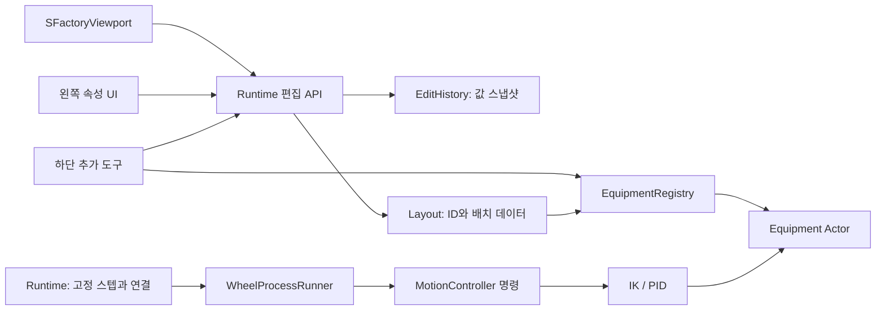

# 공장 편집기·공통 설비·팀 통합 규약

수정일: 2026-10-27

이 문서는 현재 C++ 구현과 팀원의 확장 방법을 설명한다. 이전 설계안에 있던 모든 범용 기능이 구현된 것은 아니다. 아래 구현 표와 후속 범위를 구분한다.

## 1. 현재 구현

| 책임 | 실제 클래스/파일 | 상태 |
|---|---|---|
| 배치 데이터·JSON | `FFactoryLayout`, `FFactoryLayoutItem` | v2 저장, v1 읽기, ID·참조·범위 검증 |
| 편집 기록 | `FFactoryEditHistory` | 값 스냅샷 최대 100건, Undo/Redo, 드래그 묶기, Esc 취소 |
| 입력·카메라 조작 | `SFactoryViewport`, `FactoryRuntimeEditor.cpp` | Slate 포커스와 실제 UI hit test 사용 |
| 속성/추가 도구 | `FactoryRuntimeUI.cpp` | 왼쪽 속성, 하단 등록 목록·분류·배치 |
| 설비 정의·생성 | `UFactoryEquipmentDefinition`, `UFactoryEquipmentRegistry` | 네이티브 DataAsset, TypeId → Actor 클래스 |
| 설비 외형·좌표 | `AFactoryEquipment`, `AFactoryRobotEquipment` | 도형 및 기존 KUKA 링크 메시 |
| 설비 명령·제어 | `UFactoryMotionController`, `UFactoryRobotController` | 요청 생명주기, 직교 PID / 6축 IK·관절 PID |
| 공정 | `UFactoryProcessRunner`, `UFactoryWheelProcessRunner` | 추상 확장점 및 앞왼쪽 휠 운반·정렬 1개 |
| 전체 연결·시계·화면 상태 | `AFactoryRuntime` | 배치 적용, 1/120초 고정 스텝, 공정/표시 연결 |

기존 GameMode와 다른 시험 맵을 바꾸지 않기 위해 입력 소유자는 새 PlayerController 대신 **Slate 뷰포트 위젯**으로 구현했다. Actor의 `EnableInput`/마우스 키 바인딩은 제거했다. UI에서 소비한 입력이 배경 편집으로 중복 전달되지 않는다.

`FFactoryLayoutDocument`, 별도 Inspector/Palette 위젯 클래스, 범용 부품 레지스트리, 작업 종류 선택/레시피 편집기는 아직 없다. `Layout` 데이터와 실행 결과는 현재 Runtime이 소유하고 휠 Runner가 참조한다. 새로운 작업 종류가 실제로 들어올 때 이 경계를 확장한다.

## 2. 의존 구조와 디자인 패턴



- **Registry/Factory**: TypeId로 정의와 C++ Actor를 찾는다. 하단 버튼은 목록에서 생성한다. UI에 새 설비마다 버튼 조건문을 추가하지 않는다.
- **Command/Memento 방식의 편집 기록**: 변경 전 배치 값과 선택 ID를 저장한다. Actor 포인터는 보관하지 않는다. 동일 동작 취소 후 Actor는 데이터에서 다시 만든다.
- **구성과 Strategy/Adapter**: 메시와 장치 제어를 분리한다. 기존 KUKA 메시를 네이티브 Actor로 재사용하고 제어 컴포넌트가 역기구학과 PID를 제공한다.
- **상태 머신**: 휠 공정이 접근·인수·상승·운반·정렬·검사·완료를 관리한다. 장치 명령 수락과 실제 완료를 구분한다.
- **Delegate**: `OnTerminal`은 명령 하나에 완료/취소/실패를 한 번 알린다. 현재 휠 Runner는 요청 ID와 완료 상태를 고정 스텝마다 확인한다.

싱글턴, 전역 Actor 검색으로 작업 대상 추측, 설비별 키 입력, 메시 이름으로 공정 판단을 추가하지 않는다. 패턴 이름보다 책임과 소유권을 유지하는 것이 목적이다.

## 3. 편집기 동작

- 왼쪽: 속성, 실행/정지/편집 복귀, 공장 크기, 표시 설정, 작업 연결, 공정 순서, A/B 저장.
- 하단: 전체/구역/로봇/설비 목록, 격자 맞춤, 배치 취소. 항목 선택 후 바닥 클릭, 구역은 드래그.
- 좌클릭 드래그: 이동. 휠클릭 드래그: 평행 이동. 우클릭 드래그: 입체 시점 회전. 휠: 확대/축소. WASD/방향키: 보조 이동. F: 선택 초점.
- Ctrl+Z: Undo, Ctrl+Y 또는 Ctrl+Shift+Z: Redo. 텍스트 입력 중에는 텍스트가 단축키를 소유한다.
- Esc: 진행 중 이동·크기·신규 배치를 취소한다. 카메라는 Undo 대상이 아니다.
- 공장 테두리 선택 또는 구역 선택 후 노란 변/모서리 손잡이를 드래그한다. 반대편은 고정하며 회전 구역은 로컬 축에서 계산한다.
- 공장 왼쪽 경계 이동은 `HallOrigin`과 크기를 바꾼다. 내부 설비의 월드 위치/크기는 보존한다. 구역과 내부 설비를 함께 이동하는 정책은 보류한다.
- 구역 이름은 기본 숨김이다. `시점 → 구역 이름 표시`, 설비 이름, 공정 흐름은 각각 켜고 끈다. 보기 설정은 `Saved/FactoryEditorView.json`에 저장하며 배치 Undo/JSON과 분리한다.
- 새 작업 흐름은 ID 목록으로 명시한다. 선택 항목을 추가/제외하거나 앞/뒤 순서로 옮긴다. 곡선은 구역/정지대 로컬 축을 따라 연결하며 굽힘 값을 조절한다. 방향 표시이며 차량 운반·컨베이어 구동을 계산한 결과가 아니다.

이동/크기 드래그 1회는 Undo 1건이다. 삭제 Undo는 원래 ID와 작업 연결·흐름을 복원한다. 불러오기/기본 복원도 Undo 대상이지만 저장 파일 자체를 되돌리지는 않는다. 새 편집은 Redo 분기를 버린다. 저장 후 상태와 현재 JSON을 비교해 변경 표시를 계산한다.

## 4. 설비 정의와 모델 교체

현재 소스는 `Source/test1/Factory*.h/.cpp`에 있다. 팀원 에셋은 `Content/DigitalTwin/Equipment/<TypeName>`에 두는 것을 권장한다.

`UFactoryEquipmentDefinition` 필드:

| 필드 | 의미 |
|---|---|
| TypeId | 영문/숫자/밑줄/하이픈 고유 이름, 저장 후 임의 변경 금지 |
| NameKo / NameEn | 한국어 / 영어 표시명 |
| Category | 하단 분류: 구역, 로봇, 설비 |
| Kind | 기존 역할 분류: zone, vehicle_station, wheel_supply, cartesian_handler, kuka_robot, conveyor |
| FootprintCm | 바닥 중심 기준 점유 크기(cm), 표시/검사에 사용 |
| ActorClass | `AFactoryEquipment`를 상속한 네이티브 C++ 클래스 |
| VisualMesh | 단일 도형 설비의 외형 교체 메시 |
| Description | 한국어 도움말, 지원/미지원 동작 설명 |

새 정의는 Runtime의 `ExtraEquipment`에 추가한다. 같은 ID 중복, Blueprint Actor 클래스, 유효하지 않은 크기/이름은 등록을 거부한다. 기본 정의는 `UFactoryEquipmentRegistry::Initialize()`에 있다. 새 **외형/제어 구현**은 같은 Kind에 다른 TypeId로 등록할 수 있다. 완전히 새로운 역할/명령 분류는 모델/검증 스키마도 확장해야 한다.

네이티브 DataAsset은 설정 데이터다. Blueprint 로직을 사용하는 것이 아니다. 정의를 추가/변경한 뒤 Play를 다시 시작해 등록 목록을 구성한다.

일반 설비 모델은 cm 단위, 바닥 중심 원점, +X 전방/+Y 우측/+Z 위를 기준으로 준비한다. 차량 원본의 별도 좌표계는 기존 차량 어댑터에서만 처리한다. 메시 스케일을 바꿔 로봇 도달 반경을 임의로 늘리지 않는다.

`FunctionalRoot`는 설비 기준 좌표, `VisualRoot`는 교체 외형이다. 공정은 눈에 보이는 메시 꼭짓점에서 장착점을 추측하지 않는다. 현재 공급점은 공급대 로컬 `(0,0,90)cm`, 차량 원점은 정지대 로컬 `(240,0,25)cm`이며 휠 허브는 차량의 저장된 피벗에서 계산한다. 다중 포트·명명된 기준점 목록은 후속 범위다.

## 5. 장치 제어 계약

장치 Actor는 `CreateController()`를 오버라이드해 자기 `UFactoryMotionController` 파생 컴포넌트를 만든다. 다음 함수가 실제 확장점이다.

```cpp
virtual TArray<double> Home() const;
virtual bool Solve(const FTransform& WorldGoal,
                   TArray<double>& Solution,
                   const TArray<double>& Seed) const;
virtual FTransform Forward(const TArray<double>& Joints) const;
virtual void Limits(int32 Axis, double& Min, double& Max,
                    double& Speed, double& Acceleration) const;
```

- `Solve`는 실패 시 실제 Actor/관절을 변경하지 않는다. 관절 제한을 지키는 후보를 구한다.
- `Forward`는 현재 관절에서 **월드 TCP 자세**를 반환한다. 설비 이동/회전은 소유 Actor Transform을 통해 반영한다.
- 로봇의 각도·속도·가속도 단위는 deg, deg/s, deg/s²다. 직교 축은 cm, cm/s, cm/s²다.
- `UpdateTool`은 제어 결과를 화면 링크에 적용한다. 공정이 링크 Transform을 직접 수정하지 않는다.
- `RequestMove({Epoch, Sequence}, WorldGoal, Error)`의 true는 수락이다. 완료는 `Status()==Completed` 및 같은 RequestId로 확인한다.
- Busy, 오래된 Epoch, 중복 Sequence, 도달 불가는 명령을 거절한다. Runtime이 전역 Sequence를 증가시키며 Reset/Rebuild마다 Epoch를 증가시킨다.
- `Step`은 Runtime 고정 시계에서만 호출한다. Actor/Component Tick에서 중복 적분하지 않는다.
- Stop은 현재 자세와 잡고 있는 휠을 유지하고 명령을 Cancel한다. Reset은 **현재 배치**의 Home/공급 위치로 되돌린다. 늦게 온 이전 실행 명령은 거절한다.

현재 PID는 토크 구동기가 아니라 **속도·가속도 제한이 있는 이상적인 관절 응답 모델**이다. Kp=36, Ki=0.1, Kd=12, 포화 시 적분 제한, 목표 근처 적분 감쇠를 사용한다. KUKA 제한은 시험용 ±175°(6축 ±350°), 45°/s, 90°/s²다. 실제 제조사 사양/하중에 맞춘 보정값이 아니다.

KUKA 관절 프레임과 링크는 기존 `BP_KUKA_Robot_InputFixed`에서 읽어 확인했지만 공장에서는 그 Blueprint를 실행하지 않는다. `FFactoryRobotKinematics`의 로컬 Z축, 링크 Transform, 6D 수치 IK를 C++로 사용한다. 휠용 단순 그리퍼와 TCP 오프셋은 프로젝트 가정이다. 다른 로봇에 이 파라미터를 그대로 복사하지 않는다.

## 6. 공정과 팀원 작업 통합

공정은 `UFactoryProcessRunner`의 `OperationType/Validate/Start/Stop/Reset/Step` 계약을 따른다. 현재 구체 구현은 `wheel_transfer` 한 개이며 Runtime이 이 Runner를 생성한다. 작업 상태/결과 표시를 위한 Runtime 연결은 현재 휠 전용이다.

**새 설비와 새 작업은 다르다.** 휠 작업을 수행하는 로봇을 새로 만드는 경우 기존 Runner와 제어 계약을 사용할 수 있다. 컨베이어 운반, 도어 인계, 체결처럼 새로운 작업은 전용 Runner와 대상/포트/완료 조건이 필요하다. 해당 작업을 선택하는 UI·레시피 등록은 아직 자동 생성되지 않는다. 팀원이 첫 새 작업을 제공할 때 OperationType 등록, 범용 결과 모델, 저장 작업 목록을 함께 추가한다.

컨베이어 담당자는 다음을 준비한다.

1. 바닥 기준 Actor, 입구/출구 로컬 Transform, 바닥 점유 형상, 모델·재질·라이선스.
2. 속도/길이/적재 제한의 단위와 허용 범위. 외형과 기능을 분리한다.
3. 부품 인수/이송/인계, 수신 준비 또는 막힘, 정지/초기화, 실패 결과.
4. `UFactoryProcessRunner` 파생 작업, 자기 시험 맵, 예제 배치.
5. 두 컨베이어 인스턴스의 독립 상태, 이동·90° 회전, Stop/Reset, 저장 복원 검사.

입구가 있는 메시만 가져오면 운반 기능이 생기는 것은 아니다. 부품 하나의 소유자는 한 곳이어야 하고 수신 준비 확인 후 인계한다. 현재 휠 하나는 Runner의 보유 상태로 관리한다. 다중 부품 레지스트리·자원 예약·대기열은 다음 라인 시뮬레이션 단계다.

공통 UI에는 공장/구역/위치/방향/이름이 구현되어 있다. 임의 설비 설정 메타데이터에서 동적으로 속성 창을 만드는 기능은 아직 없다. 새 속도·하중 설정을 추가할 때 TypeId별 검증과 JSON 버전도 함께 제공한다.

## 7. 저장 v2와 호환성

v2는 `hall.origin_cm`, 각 항목의 `type_id`, `process_order`, `route_bend_cm`을 추가했다. v1의 Kind는 TypeId로 읽고 원점은 `(0,0)`으로 둔다. 기존 P01~P06가 있으면 그 ID 순서를 초기 흐름으로 사용한다. 기존 직교 장치를 저장 불러오기 과정에서 KUKA로 자동 교체하지 않는다.

현재 `job`은 여전히 단일 휠 작업의 `station_id/supply_id/handler_id`다. 설비 정의 버전, 임의 Parameters, 다중 Operation 목록, 제품 시작 정의, 포트별 Route는 후속 스키마 대상이다. v2 구현이 이것까지 포함한다고 해석하지 않는다.

- 저장: `Saved/FactoryLayouts/layout_A.json`, `layout_B.json`. 기존 파일은 `.bak` 백업 후 교체한다.
- 기존/알 수 없는 버전, 잘못된 ID·참조, 등록되지 않은 TypeId는 현재 배치를 유지하며 로드를 거부한다.
- 불러오기 전 전체 데이터/등록 정의를 검증한다. 삭제된 설비를 누락시킨 부분 로드는 하지 않는다.
- Actor 포인터, 현재 관절 속도·명령, Undo 기록, 카메라는 JSON에 저장하지 않는다.
- 보기 설정은 별도 `Saved/FactoryEditorView.json`이다. 팀 공유 예제는 `Scripts/factory_editor_default_v2.json`이다.
- `.umap` 저장과 Play 배치 저장은 별개다. A 슬롯이 있으면 Play 시작 시 사용자 배치가 기본 예제보다 우선한다.

## 8. 검증과 한계

네이티브 게임 검사 50개: 기존 직교 작업, 스키마, 저장 복원, Undo/Redo, 드래그 묶기, 삭제 연결, 회전 구역/공장 원점 크기 조절, 이름 표시, 등록 거절, KUKA 자세 IK·PID·명령 수명, 90° 이동/회전 셀. 검사 결과는 `Saved/FactoryRuntimeTestReport.json`에 남는다. UI hit test/마우스·키 이벤트와 렌더는 `Scripts/TestFactoryEditorUI.ps1`로 별도 확인한다.

시험용 KUKA 기본 사이클은 약 23.38 시뮬레이션 초였다. 이는 현장 택트타임이나 제조사 장비 성능이 아니다. 위치 오차는 가상 좌표의 차이다. 실제 센서 측정·체결 합격으로 표시하지 않는다.

링크 전체/차량 접촉·자가 충돌·실제 하중/토크/응력/진동·파지 손실·나사 체결은 아직 계산하지 않는다. 경로 검사는 휠의 단순 이동 구간과 설비 바닥 점유 형상 기준이며 활성 공급대/차량/로봇은 제외한다. 실제 안전거리 인증이 아니다. 전체 생산량·병목 비교는 버퍼·투입·고장·재작업·물류를 추가한 뒤 검증한다.

## 9. 협업 규칙

- Actor·제어·UI는 C++; Blueprint 로직 사용 금지. 설정용 네이티브 DataAsset 허용.
- UI·알람·도움말은 한국어 우선, 이름은 한국어 (English). 내부 ID는 안정적인 영문.
- 팀원별 시험 맵을 사용하고 공용 `factory_p1.umap` 수정 담당자를 정한다.
- 같은 종류 2개, 이동/90° 회전, 삭제 Undo, 저장/새 로드, Stop/Reset을 통합 기본 검사로 한다.
- TypeId와 로컬 기준점/명령 의미가 바뀌면 먼저 규약과 저장 호환성을 갱신한다.
- 코드 본문 수정은 가능한 경우 Live Coding을 쓴다. 새 클래스/객체 구조를 바꾸는 통합에서는 전체 빌드와 새 프로세스 재로드 검증을 수행한다. 브랜치별 DLL을 임의 복사하지 않는다.

관련 문서: [개발 계획](DEVELOPMENT_PLAN.md), [factory_p1 사용법](<unreal projects/test1/FACTORY_P1.md>), [공정 근거](ASSEMBLY_PROCESS_PLAN.md), [물리 원칙](PHYSICS_DESIGN_PRINCIPLES.md), [지그 원칙](FIXTURE_DESIGN_PRINCIPLES.md).

2026-10-27 최종 화면 검사: 8개 Slate 검사(작업 화면/왼쪽/하단 hit test, 휠클릭 이동, 우클릭 회전, Ctrl+Z/Y, 텍스트 포커스 분리)와 1600×900 렌더·휠 사이클을 통과했다. 실제 OS 마우스 주입이 아닌 프로그램 생성 Slate 이벤트 검사다. 패키징 실행과 장시간 다중 설비 부하 시험은 미검증이다.
