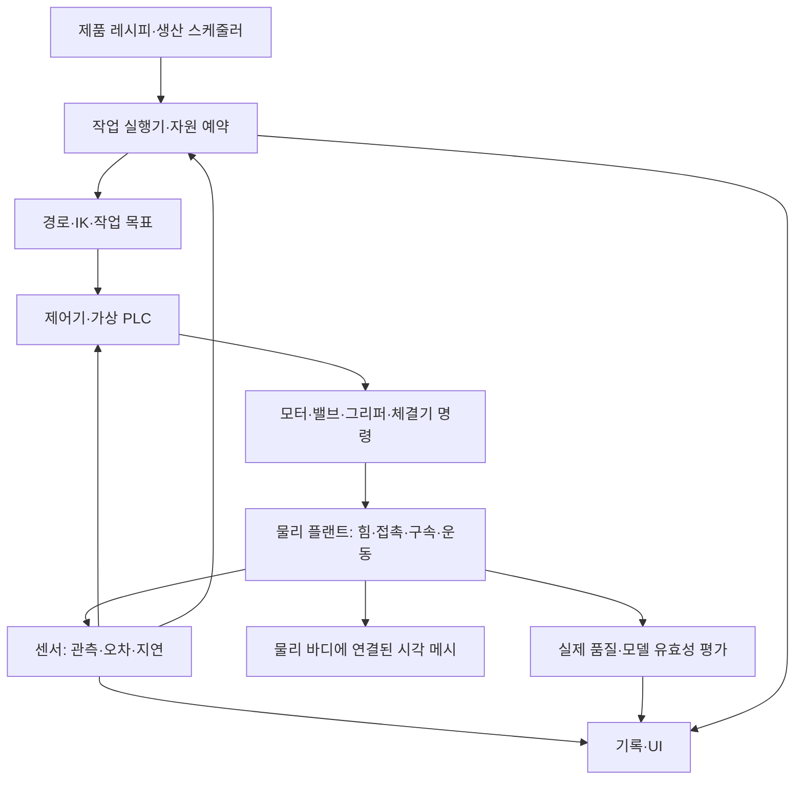

# 자동차 조립 공장 디지털 트윈 — 물리·센서·생산 시뮬레이션 전환 계획

작성일: 2026-11-11 (한국 시간)  
상태: **현행 C++ 코드 점검에 근거한 설계·수정 계획. 아래 목표 기능을 구현 완료했다는 뜻이 아니다.**  
대상: `factory_p1`, 통합 조립 라인, 공통 설비·작업 계층 및 관련 시험용 실행 경로. 구현은 C++를 기준으로 하고 Blueprint 작업 로직은 추가하지 않는다. UI는 한국어 우선, 필요한 경우 `한국어 (English)`를 병기한다.

## 1. 목표와 적용 범위

목표는 차체 한 대의 조립 동작을 재생하는 것이 아니라, **차체·부품 반입 → 센서 인식 → 운반·고정 → 조립 → 검사 → 인계·배출을 반복하는 생산라인**을 구성하고, 배치·설비 수·물성·제어·공급 조건의 변경이 양품 생산량과 고장에 미치는 영향을 비교하는 것이다. 휠·도어는 첫 적용 사례이며 공통 구조를 이 부품들에 종속시키지 않는다.

모든 현상을 같은 정밀도로 계산한다는 뜻은 아니다. 강체 역학, 구동기·공압의 축소 모델, 가상 계측, 공정의 이산 사건 모델을 결합하되 **각 현상의 원인과 결과, 모델의 유효 범위, 생략한 요소를 명시**한다. 센서 전자회로나 공장 전체 유체를 모두 풀지 않아도 되지만, 생략한 효과를 계산했다고 표시해서는 안 된다.

실측 공장과의 연계·보정이 확보되기 전에는 물리 기반 디지털 트윈 프로토타입이다. 특정 Tesla 공장, Camry 실차 또는 실제 설비의 정확도를 이미 재현했다고 주장하지 않는다. Camry 내연기관 자산과 EV 공정은 별도 제품 레시피로 구분한다.

### 1.1 문서 간 관계

- 본 문서: 공장 전체의 물리 전환 범위, 현행 코드 교체 목록, 공통 계약과 검증 순서.
- [기존 물리 설계 원칙](PHYSICS_DESIGN_PRINCIPLES.md): 도어의 물성·응력·탄성·진동 모델 상세. 과거 단일 셀 일정은 이력이며 본 문서의 전체 공장 목표를 제한하지 않는다.
- [지그 설계 원칙](FIXTURE_DESIGN_PRINCIPLES.md): 로케이터·패드·공차·접촉 후보 및 하중 경로.
- [공통 설비 구조](FACTORY_ARCHITECTURE.md), [작업 연결 규약](FACTORY_TASK_CONTRACT.md): 등록·설비·작업·부품 ID와 팀 통합. 본 문서의 물리 계약을 추가 적용한다.
- [공정 계획](ASSEMBLY_PROCESS_PLAN.md): 제품별 공정 순서와 모듈 분류. 현재 시험 순서가 모든 차량의 실제 제조 순서라는 뜻은 아니다.
- [UI 규약](FACTORY_UI_CONTRACT.md): 실제값·측정값·명령값·판정 근거의 표시 위치.

현재 상태와 앞으로의 요구사항을 구별한다. 이전 문서의 시간 기반 체결·직접 추종은 기존 시연 구현 설명이며, 신규 물리 모드의 합격 기준으로 사용하지 않는다.

## 2. 변경하지 않을 원칙과 폐기할 실행 방식

### 2.1 유지할 것

- FK/IK, 목표 경로·궤적 생성, 좌표계 변환, 기하학적 오차 계산.
- 설비·작업·부품 등록과 할당, 편집 UI, Undo/Redo, 저장·복원, 로그 구조.
- 편집 모드의 배치와 Reset 시 초기 조건 설정.
- 물리 계산 결과를 렌더 메시로 전달하는 시각 갱신. 외부 솔버를 쓰면 Transform 설정도 정상적인 출력 방법이다.
- 상태 머신, PLC 논리, 타임아웃, 최소 안정 시간. 다만 시간 경과만으로 실제 작업 성공을 만들어내지는 않는다.

### 2.2 물리 실행 모드에서 금지할 것

- 작업 코드가 부품·관절의 위치를 직접 덮어써서 운반·정렬·체결을 성립시키는 것.
- `GripCommand=true`를 실제 파지로, `CloseCommand=true`를 충분한 클램핑으로, 경과 시간을 체결 품질로 간주하는 것.
- 부품이 목표점과 가까우면 충돌·안착·하중 전달 검증 없이 영구 부착하는 것.
- 물리 객체와 렌더 메시가 분리된 채 서로 다른 위치를 기준으로 검사하는 것.
- 센서가 실패했을 때 제어기가 몰래 내부 실제 자세를 읽어 계속하는 것.
- 정상적인 미끄러짐·탄성 변위·진동을 단순 Transform 불일치로 제거하는 것.
- 실행 중 충돌을 피하려고 순간이동, 무한 힘, 임의 속도 0 설정, 숨김·재생성을 사용하는 것.

고정 바닥·고정 로봇 베이스는 정적 경계조건으로 둘 수 있다. 지정 운동을 주는 이상적인 구동원도 별도 근사 모드에서는 가능하지만, 그 구동원의 부하 응답·소비 에너지·정지거리를 검증했다고 주장하지 않는다. 정상 물리 모드와 근사 시연 모드를 결과에 구분해서 기록한다.

## 3. 현행 코드 점검 및 전환 목록

2026-11-11 작업 트리의 C++ 기준이다. 바이너리 맵의 모든 인스턴스 설정이나 Live Coding 중인 프로세스 전체를 재검증한 결과는 아니다. 아래의 함수 이름을 검색 기준으로 사용한다. 코드는 모두 `unreal projects/test1/Source/test1/` 아래에 있다.

| ID | 현재 파일·함수 / 범위 | 확인한 구현과 한계 | 변경 계획 |
|---|---|---|---|
| A01 | `RobotArm.cpp`: `StepControl`, `UpdateVisuals`; `RobotControlMath.cpp`: `FRobotJointController::Step` | 속도 PID와 응답 시간상수·속도/가속도 제한으로 각도를 적분. 링크 하중·접촉 반력 없음 | IK·궤적은 유지. 동역학 플랜트와 실제 관절 측정 피드백으로 교체 |
| A02 | `RobotArm.cpp`: 생성자; `VehicleProcessTest.cpp`: `RebuildVisuals`; `CamryAssembly.cpp` | 주요 시각 메시를 `NoCollision`으로 구성 | 시각 에셋과 별도로 검증한 충돌 형상·물리 바디·질량 정의를 추가. 시각 메시 자체에 충돌을 중복 적용하지 않음 |
| A03 | `WheelAssemblyCell.cpp`: `GetPhysicalPartWorld`, `SetPhysicalPartWorld`, `StepLane` | 이름에 Physical이 있어도 SceneComponent 자세. 운반은 TCP에 맞춰 직접 이동 | PartId가 실제 물리 바디를 가리키도록 변경. 운반은 그리퍼 접촉·구속의 결과 |
| A04 | 같은 파일: `UWheelRobotSensorBank::Sample` | 내부 자세·표시 상태·그리퍼 명령·기하 오차로 존재·파지 측정 생성 | 실제 접촉/그리퍼 상태와 관측 모델에서 센서 생성. 화면 가시성을 부품 존재와 분리 |
| A05 | 같은 파일: `StepLane`의 `Fasten`, `UpdateFastenedWheels` | 정렬 유지+설정 시간 뒤 체결 플래그. 이후 차체 상대 자세 직접 추종 | 체결기·볼트/너트·허브 결합 모델, 실제 지지 전환과 품질 평가 |
| A06 | 같은 파일: `Align`의 독립 검증 | 일부 경로에서 정렬과 동일한 `MountPose`를 다시 사용 | 별도 관측 채널·오차 모델 또는 명시적인 실제 상태 평가기로 분리 |
| A07 | `DoorAssemblyCell.cpp`: `FixedUpdate`, `AdvanceSimulation` | TCP 추종, 시간 기반 이상적 강체 체결, 차체 자세 추종 | 도어 운반·인계는 공통 파지/지지 계약. 힌지 체결은 별도 지원 모델일 때만 활성화 |
| A08 | 같은 파일: `SimulatePoseSensor`, `MeasureSensors`; `DoorInspectionComponent.cpp`: `EvaluateDoorPose` | 실제 자세+설정 편차, 기준 6점 투영. 표면 전체·변형 계측은 아님 | 기하 계산은 유지하되 센서 입력·변형된 검사 형상·측정 유효성을 연결 |
| A09 | `SensorAssemblyLine.cpp`: `UConveyorPlant::Step` | 가속도 제한 속도로 차량·대차를 직접 이동. 질량·마찰·구동력 없음 | 대차/레일 또는 벨트/롤러 방식별 구동·저항·접촉·제동 모델 |
| A10 | 같은 파일: `UArrivalSensorBank::Sample`, `FixedStep` | Actor 위치의 영역 포함 여부와 위치 차분으로 도착·속도 관측. 도킹은 위치/속도 안정 중심 | 센서 설치 형상·지연·오차를 적용. 도착·정지·고정 완료를 구분 |
| A11 | `IntegratedAssemblyLine.cpp`: `AdvanceLine`; `WheelAssemblyCell.cpp`: `SetTransportProgress` | 공정 사이 차체·대차 위치를 시간 보간. 도어 공급 자세도 반복 고정 | 반입부터 공정 간 이동·배출까지 동일한 이송 실행 계약 적용. 공급 부품은 별도 물리 지지 |
| A12 | `DoorFixture.cpp` | 접촉 후보·단순 형상·상대 변위 표시. 반력·공압 계산 없음 | 지지·로케이터·클램프의 접촉, 기구·압력·강성·공차 모델 |
| A13 | `RobotArm.cpp`: `Halt`; `FactoryMotionController.cpp`: `Cancel` | 내부 속도를 즉시 0으로 변경 | 감속·브레이크·전원 상실·보유 정책을 물리적으로 계산 |
| A14 | 휠/도어 실행기의 운반 중 Transform 동일성 검사 | 예상 자세에서 벗어나면 외부 이동으로 실패 | 무단 편집은 명령 권한으로 차단. 물리 편차는 센서/접촉/품질 조건으로 평가 |
| A15 | `AutonomousAssemblyLine.cpp`: `InjectEvent`, `RestoreEvent` | 일부 고장을 가시성·플래그·좌표 변경으로 주입하고 시간 후 복원 | 공급 이벤트·센서 고장·구동 고장을 구분. 물리 고장은 압력/마찰/장애물 등의 원인을 변경 |
| A16 | `FactoryMotionController.cpp`, `FactoryRobotEquipment.cpp`, `FactoryEquipment.cpp` | 기존 별도 제어 경로도 이상적 가속도 계산과 직접 외형 갱신 | 새 플랜트 인터페이스에 연결하거나 명시적인 시연 전용으로 격리 |
| A17 | `FactoryProcessRunner.cpp`: `UFactoryWheelProcessRunner::Step` | 기존 단일 휠 실행기에서 위치 도달 후 파지 플래그, 휠 직접 추종. 현재 문구는 좌표 검사임을 표시 | 물리 모드가 이 경로로 우회하지 않도록 공통 작업 실행기로 전환 |
| A18 | `MidtermCameraCell.cpp`: `ObserveDoor`, `UpdateSequence` | 별도 시연: 알려진 도어 좌표를 영상 평면에 투영. 픽셀 검출이 아님 | 이상적 마커 센서로 명시/격리. 실제 카메라 모드는 렌더 입력과 영상 처리 구현. 현재 factory_p1의 활성 카메라라고 단정하지 않음 |
| A19 | `VehicleProcessTest.cpp`: `AdvanceMotion` | 별도 부품 이동 시험의 이상적 가속도/자세 갱신 | 편집·시험 전용 유지 또는 공통 플랜트 연결. 운반 중 동시 제어 금지 |
| A20 | `FactoryTaskModel`, `FactoryTaskAssignment`, 통합 라인 | 작업 할당은 있으나 차량 한 대 중심의 휠·도어 실행과 고정 참조가 남음 | ProductInstanceId별 부품·레시피·작업과 다중 제품 스케줄러로 확장 |
| A21 | `FactoryInspection`, 각 Cell의 결과·기존 Checks | 명령 완료·자세 오차·소프트웨어 동작 검사 중심 | 제어 완료/실제 품질/시뮬레이션 유효성을 분리하고 물리 검증 추가 |

최근 추가한 휠 메시 재연결·추종 검사도 A03/A21의 소프트웨어 일관성 보강이다. 힘 기반 파지나 체결을 구현한 것은 아니다. 기존 회귀 검사 개수는 물리 정확도의 근거로 사용하지 않는다.

## 4. 공통 실행 구조와 상태 소유권



평가기의 실제값은 분석용이다. 실제 설비에 없는 정답 신호를 PLC로 돌려주지 않는다. 모델 손상·수치 발산으로 실행을 중단하는 시뮬레이터 감독 기능은 생산 제어와 구분해 기록한다.

| 책임 | 제안 계약 — 아직 존재하는 클래스명이라는 뜻은 아님 | 허용되는 일 |
|---|---|---|
| 제품·부품 | `PartDefinition`, `ProductInstance`, `AssemblyConnection` | 형상/물성 정의, 개체 ID, 실제 결합 그래프와 이력 |
| 물리 | `IPlantBackend`, `PlantSnapshot` | 한 바디의 실제 상태를 유일하게 적분·갱신 |
| 구동기 | `IActuatorModel` | 명령→힘/토크/압력/밸브 응답. 한계·효율·고장 |
| 센서 | `ISensorModel`, 기존 ObservationProvider 확장 | 실제 상태 또는 영상→관측 패킷. 제어기에는 관측만 제공 |
| 제어 | `IEquipmentController` | 측정/추정→구동 명령, 인터록. 실제 Transform 쓰기 금지 |
| 작업 | `IOperationExecutor` | 운반/정렬/체결 등의 절차·시간 초과·요청 ID |
| 생산 | `ProductionScheduler` | 선행 조건, 물류, 버퍼·작업·공간 자원 예약 |
| 평가 | `QualityEvaluator`, `ModelValidityMonitor` | 품질과 모델 유효성 별도 판정. 생산 제어에 정답 누설 금지 |

Registry/Factory는 생성, Adapter는 팀원 코드 연결, Strategy는 센서·구동·공정 모델 교체에 사용한다. 상태 머신은 절차에 사용하며 역학 계산을 거대한 상태 전이 함수 안에 넣지 않는다. 클래스 상속보다 구성으로 조합하고, 불필요한 인터페이스부터 대량 생성하지 않는다.

**제어 소유권과 물리 접촉은 다르다.** 한 바디의 상태 작성자는 하나지만 그리퍼·받침·허브가 동시에 그 바디에 힘을 줄 수 있다. 인계 중 필요한 다중 접촉을 “소유자는 하나”라는 이유로 제거하지 않는다. 두 로봇 협업은 명시적으로 조정된 작업과 하중 분담 모델을 요구한다.

## 5. 물성·형상·단위 데이터

| 구분 | 필수 데이터와 검증 |
|---|---|
| 바디 | 질량 kg, 무게중심, 대칭·물리적으로 유효한 관성 텐서 kg·m², 해당 좌표계, 초기 자세/속도 |
| 재질·접촉 | 재질 쌍별 정지/운동 마찰, 반발·감쇠, 접촉 강성 또는 솔버 모델, 적용 속도/하중 범위 |
| 형상 | 렌더 메시, 충돌 형상, 정밀 검사 형상, 접촉면·포트·조립 기준. 서로의 변환과 버전 |
| 로봇 | 링크별 물성, 축·관절 제한, 감속비, 최대/연속 토크, 속도·가속도·열 한계 중 구현 범위 |
| 툴 | 자체 질량·관성, TCP, 파지부 형상, 구동력, 허용 힘·모멘트, 센서 구성 |
| 지그 | 접촉 위치·법선·면적, 스트로크, 강성, 공차, 핀/구멍 유격, 마모·설치 편차 |
| 제품·결합 | 구성 부품 목록, 허브/힌지/브래킷 등의 결합 상대, 자유도, 축력·강성·파손 한계 |
| 센서 | 설치 자세·보정 정보, 단위, 갱신 주기, 지연·분해능·노이즈·편차·오차 상관 |
| 구동·공급 | 전원/공압 조건, 밸브/모터 응답, 공급 수량·위치·단위, 보충 규칙 |

모든 계수는 `실측 / 제조사 자료 / 원본 해석 데이터 / 보정 / 가정`을 표시하고 출처·버전·불확실성·유효 범위를 저장한다. 원본 .key의 일부 셸 질량을 유리·트림·모터가 포함된 완성 도어 질량으로 쓰지 않는다. 외형 교체와 물리 모델 변경은 별개의 버전 변경이다.

계산 모델의 기준 단위는 SI(m, kg, s, N, N·m, Pa, rad)이다. UE Transform의 cm, 기존 API의 deg, 표시 mm/bar는 경계에서 변환한다. 좌표계의 손잡이 방향과 회전·토크 부호도 시험한다. **UE에 넘기는 힘·토크·관성의 수치 단위를 각 실제 API와 엔진 소스로 확인**하며, 이름만 보고 N 또는 N·m를 그대로 전달하지 않는다. 예를 들어 kg·cm·s 기반 원시 수치라면 힘·토크 환산 차원이 각각 길이 1승·2승인 점을 단위 시험으로 검증한다.

결합한 부품의 질량은 원래 바디와 합성 바디 양쪽에서 중복 계산하지 않는다. 합성 바디를 만들 경우 무게중심과 평행축 정리를 반영한 관성을 갱신하고, 분리 시 구성과 운동 상태를 일관되게 복원한다.

## 6. 구현해야 할 물리 모델

### 6.1 강체·충돌·접촉 — 모든 움직이는 물체의 공통 기반

- 부품·차체·대차·로봇 링크·툴·공급 지지대에 실제 상호작용을 담당하는 바디/접촉면을 정의한다.
- 병진 운동 `m·a = ΣF`, 회전 운동은 관성과 각속도에 따른 항을 포함해 솔버가 계산한다. 힘은 작용점·방향과 함께 적용하여 토크가 발생하게 한다.
- 동적 부품의 떨어짐·구름·미끄러짐·충돌 후 응답을 계산한다. 접촉 정상력과 마찰이 없는 부품을 공중에 정지시키지 않는다.
- 렌더용 고해상도 CAD를 그대로 모든 동적 충돌에 사용하지 않는다. 단순/복합 볼록 형상을 사용하되 허브 구멍·안착면·그리퍼 접촉면 같은 기능 형상은 보존한다.
- 얇은 패널, 작은 간극, 고속 이동은 충돌 형상·연속 충돌 검출·시간 간격과 허용 침투를 함께 검토한다. 눈에 닿아 보여도 충돌 형상이 다르면 접촉 결과가 틀릴 수 있다.
- 품질 공차와 비교해 형상 근사·솔버 허용 침투·수치 오차가 충분히 작은지 오차 예산을 세운다. mm 단위 값을 출력할 수 있다는 사실은 mm 정확도의 접촉/계측을 보장하지 않는다.
- UI 선택용 영역과 공정의 충돌/감지 영역을 분리한다. 이웃 링크 충돌 제외도 접합부 등 의도한 쌍에만 적용한다.

UE의 `UseComplexAsSimple` 설정은 해당 객체 자체를 동적 시뮬레이션하는 용도로 사용할 수 없다는 제한이 있으므로 동적 부품용 충돌 자산을 따로 준비한다. [Epic 충돌 형상 문서](https://dev.epicgames.com/documentation/en-us/unreal-engine/simple-versus-complex-collision-in-unreal-engine)

### 6.2 차체 반입·공정 간 이송·배출

먼저 실제 설비 방식을 선택한다. 레일 대차, 벨트, 롤러, AGV는 같은 모델의 외형 교체가 아니다.

| 방식 | 계산할 원인·결과 | 필요한 관측 |
|---|---|---|
| 레일 대차 | 구동력/토크, 레일 구속, 구름 저항, 적재 질량, 제동, 도킹 스토퍼 반력 | 엔코더, 도착/위치/속도, 구동 전류 또는 토크 |
| 벨트 | 모터·벨트 속도와 적재물 사이 접촉·마찰, 미끄러짐, 부하에 따른 응답 | 벨트 속도, 물체 도착, 물체 속도, 구동 부하 |
| 롤러 | 롤러 회전·구동 한계·접촉, 지지 간격, 적재물 흔들림 | 회전·점유·막힘 감지 |
| AGV/이동로봇 확장 | 구동 바퀴·차량 운동, 적재 하중, 제동·장애물, 경로·교통 제어 | 위치 추정·장애물·속도. 지상 정답 좌표와 구분 |

대차 위 차체는 지지점·클램프·연결의 반력으로 이동한다. 차체와 대차를 각각 같은 거리만큼 좌표 이동시키지 않는다. 도킹은 도착 → 감속 → 안착 → 고정 → 고정 확인을 구분한다. 다음 공정의 준비/공간이 없으면 버퍼 또는 정지 정책에 따라 대기한다. 같은 모델을 반입·공정 사이·배출에 사용하여 중간에 보간 이동으로 우회하지 않는다.

### 6.3 로봇 관절·모터·제어

다관절 운동의 개념식은 `M(q)·q̈ + C(q,q̇)·q̇ + g(q) + τ_f = τ_drive + J(q)ᵀ·w_external`이다. 이를 별도 구현하거나 검증한 강체 솔버가 담당하게 한다. 서로 같은 중력·마찰·관성 항을 중복 적용하지 않는다.

- 기존 IK는 관절 목표를, 궤적 생성기는 시간별 위치·속도/가속도 목표를 제공한다. IK 성공은 경로의 충돌 회피나 하중 가능성 보장이 아니다.
- 제어 출력이 위치·속도·전류·토크 중 무엇인지 명시한다. 위치/속도 루프 뒤에 실제 구동 응답과 토크 한계를 둬도 된다.
- 기존 속도 PID 게인을 토크 PID나 Constraint Drive에 그대로 복사하지 않는다. 단위·샘플링·포화·적분 누적 방지와 부하 응답을 다시 보정한다.
- 실제 관절 상태를 엔코더 모델이 측정한다. 제어기나 목표 배열을 실제 자세의 유일한 근거로 삼지 않는다.
- 링크·툴·들고 있는 부품의 중력·관성 하중과 접촉 반력이 로봇에 전달되어야 한다. 충분한 구동 여유가 있으면 무거워져도 속도를 유지할 수 있으므로, 하중 증가 시 무조건 느려지도록 인위적으로 만들지 않는다.
- 전력/에너지를 표시한다면 `τ·ω`의 기계 일률과 전기 입력·손실·회생을 구별한다. 전기 모델이 없으면 기계 에너지까지만 표시한다.
- 로봇 사이·차체·설비와의 전 링크 충돌, 툴 및 운반 부품의 부피를 고려한다. TCP 한 점의 이동 선분 검사만으로 전체 경로 안전을 판정하지 않는다.

### 6.4 그리퍼·흡착·부품 인계

그리퍼 방식은 실제 툴에 맞춰 선택한다. 손가락식에는 관절/슬라이더·패드 접촉·마찰, 내경 확장형에는 접촉 위치와 기구, 진공에는 압력 차·밀봉·유효 면적·누설이 필요하다.

- 공압 또는 모터 구동 → 손가락 이동 → 접촉 → 접촉력 형성 → 유지/미끄러짐으로 이어진다.
- `닫힘`, `접촉`, `유지 가능`, `운반 중 이탈`은 다른 상태다. 닫힘 센서만으로 부품 존재를 확인하지 않는다.
- Coulomb 마찰 근사에서는 접촉별 접선력 한계가 `μN`이지만, 전체 파지 가능성은 여러 접촉의 힘·모멘트 평형과 부품 가속도를 함께 평가한다.
- 흡착력의 단순 상한 `Δp·A_eff`는 완전한 파지 모델이 아니다. 밀봉·유출·박리 모멘트·전단 지지와 유효 범위를 정의한다.
- 처음부터 상세 패드 접촉을 풀기 어렵다면 힘·모멘트 한계와 컴플라이언스가 있는 축소 결합을 사용할 수 있다. 접촉 전 원거리에서 결합을 만들거나, 실패 시 미끄러짐 계산 없이 성공으로 유지하지 않는다.
- 받침/허브/다른 그리퍼와 인계할 때는 수신 접촉·지지가 실제로 성립한 후 송신 그리퍼를 해제한다. 상태 변경 순간에 부품 위치·속도를 임의로 초기화하지 않는다.
- 렌더 메시를 TCP에 Attach한 것은 물리 파지가 아니다. 물리 바디에 연결된 시각 메시가 계산 결과를 따라야 한다.

### 6.5 지그·클램프·공압

받침, 위치결정 로케이터, 스토퍼, 누름 클램프를 구분한다. 핀/구멍 유격·설치 편차·마모·패드 강성·부품 두께가 안착과 고정력에 영향을 주게 한다.

- 공압은 초기에는 명시한 1차 압력 응답으로 근사할 수 있다. 추후 챔버 체적·밸브 유량·누설을 포함한 집중정수 모델로 확장한다. 임의 압력 감소 곡선을 누설 유량 해석이라고 부르지 않는다.
- 실린더 힘은 동일 기준의 챔버 압력과 면적을 사용한 `F = p_cap A_piston - p_rod A_annulus - F_loss`로 시작하고 기구 각도·레버 비·효율·마찰·스트로크를 반영한다.
- 접촉은 닿았을 때 압축 반력을 내며, 음의 접촉 반력이 필요해지는 상태는 이탈로 다룬다. 모든 접촉을 양방향 고정 조인트로 만들지 않는다.
- 압력 센서, 실린더 위치, 패드 접촉, 실제 고정력과 부품 움직임을 구별한다. 압력 정상이어도 패드가 안 닿거나 이물질 때문에 안착에 실패할 수 있다.
- 여러 설비가 공압을 공유하는 시나리오에서는 동시 작동에 따른 압력 응답을 공유 공급 모델로 계산한다. 미구현이면 각 설비의 이상적 독립 공급 가정을 기록한다.

상세 입력과 공차는 [지그 원칙](FIXTURE_DESIGN_PRINCIPLES.md), 탄성·반력 식은 [도어 물리 원칙](PHYSICS_DESIGN_PRINCIPLES.md)을 적용한다.

### 6.6 휠 안착·볼트/너트 체결

휠 중심 좌표 일치와 정상 결합은 별개다. 휠·허브·체결구 형상을 확인하고 실제 구성에 맞는 모델을 선택한다. 볼트 방식과 스터드/너트 방식을 섞지 않는다.

1. 접근·정렬: 허브/구멍/안착면의 간극과 접촉을 계산한다. 잘못된 각도·이물질로 인한 저항이 로봇·툴에 전달된다.
2. 삽입·착좌: 삽입 깊이, 면 사이 간극, 접촉 안정, 상대 속도를 확인한다. 거리 조건만으로 결합을 활성화하지 않는다.
3. 체결: 스핀들 회전·속도·구동 토크, 회전 저항, 착좌 후 연결 강성·축력을 계산한다. 반작용 토크가 툴과 지지체에 전달되어야 한다.
4. 판정: 볼트별 토크–각도 이력, 허용 범위, 미착좌·누락·헛돎·걸림 조건을 평가한다. 실제 축력 평가는 센서로 관측 가능한 값과 구별한다.
5. 해제 후 검사: 그리퍼 하중이 제거된 상태에서 결합 유지·상대 운동·잔여 간극을 평가한다.

초기에는 나사산 전체 접촉 대신 회전–진입–착좌–탄성 축력의 축소 모델을 쓴다. 필요한 계수는 체결구 규격·마찰·볼트와 피체결체 강성에서 확보한다. `T≈K·F_preload·d` 형태를 사용한다면 경험적 근사와 K의 조건을 명시하고 절대적인 토크→축력 변환으로 사용하지 않는다. 마찰과 회전 저항 때문에 목표 토크 도달만으로 축력이 보장되지 않는다는 근거는 [Atlas Copco 체결 기술 자료](https://www.atlascopco.com/content/dam/atlas-copco/industrial-technique/general/documents/pocketguides/9833864801_L.pdf)를 참고한다.

초기 합격 지표에서 주장하지 못하는 나사산 손상·풀림 수명·피로는 미지원으로 표시한다. 휠은 허브에 결합하며 허브·현가장치의 필요한 자유도는 유지한다. 차체 전체에 영구 고정해서 회전·하중 전달을 없애지 않는다.

### 6.7 도어 운반·지지·힌지 작업

기본 도어 작업은 체결 전 위치까지 운반하고 지지/인계하는 것이다. 물리적 힌지 체결 모델이 없는 실행에서 `도어 체결 완료`라고 표시하지 않는다.

- 도어의 무게중심·관성·그리퍼 위치에 따른 모멘트와 흔들림을 반영한다.
- 그리퍼 → 인계 지그/보조 장치 → 힌지의 지지 전환을 표현한다. 사람 작업이면 인계와 작업 소요·공간 점유 모델을 명시한다.
- 힌지 조립을 추가하면 연결 자유도·강성·유격, 체결 이력, 지지 해제 후 중력 처짐을 계산한다.
- 도어 주변 6점 기하 검사는 계속 활용할 수 있지만 전체 표면 간극이나 영상 계측과 동일하다고 설명하지 않는다. 탄성 모델을 넣으면 검사점이 해당 변형을 읽어야 한다.

### 6.8 탄성·응력·진동

강체 접촉 솔버만으로 판재 응력·좌굴·소성을 얻을 수는 없다. 국소 접촉부의 보/스프링 근사, 모드 기반 축소 모델 또는 오프라인 해석의 응답 데이터를 추가한다.

- 최초 모델은 특정 부위·하중·지지 조건에서 검증하고 도어 전체로 무조건 확대하지 않는다.
- 정적 변형과 동적 진동은 동일 자유도를 중복 계산하지 않도록 구분한다. `m_eff ẍ + c ẋ + kx = F(t)` 같은 축소 모델도 계수·좌표·적용 범위를 가진 물리 모델이다.
- 평균 접촉압 `N/A`를 최대 응력이라고 표시하지 않는다. 계산하지 않은 응력장을 임의 색상으로 그리지 않는다.
- 해제 후 회복·처짐과 잔류 진동이 검사 시점·단차에 영향을 주어야 한다. 선형 탄성 모델로 영구 변형을 만들어내지 않는다.
- 강체 접촉과 탄성 모델이 같은 패드 강성·변위를 이중으로 적용하지 않도록 경계를 정한다.

### 6.9 향후 작업 확장 — 필요할 때 물리 모델과 함께 추가

| 작업 | 추가해야 할 모델·측정 | 완료 조건 예 |
|---|---|---|
| 시트 운반·장착 | 무게중심·그리퍼, 가이드 접촉, 레일/볼트 결합 | 안착·체결·해제 후 유지, 레일 기능 검사 |
| 유리 장착 | 진공 흡착·밀봉, 유리 지지, 접착제 비드·압착·경화 모델 | 위치만 아니라 접착 경로 연속성·접착 조건까지 지원 범위 내 확인 |
| 콕핏/핸들 프레임 | 조립 간극, 삽입 가이드, 복수 지지·체결, 필요 시 협업 | 접촉/안착·연결·인계 조건 |
| 서브프레임·엔진/구동계 결합 | 리프트 구동·중량, 복수 마운트, 동기 제어·정렬·체결 | 지지 전환, 마운트 하중·결합 상태 |
| 실링 도포 | 노즐 이동, 유량/압력·점도 근사, 비드 형상·누락 | 목표 경로의 폭/연속성/도포량. 임의 선 그리기로 대체 금지 |
| 용접 | 접촉·가압, 전류·시간·열/접합 품질 모델 또는 검증한 축소 모델 | 지원하는 접합 품질 지표. 불꽃 효과는 판정 근거가 아님 |

이 표는 확장 요구사항이며 이번 전환에서 모두 구현한다는 약속이 아니다. 새 공정의 물리 모델·센서·품질 조건이 없으면 실행 가능 목록에 정상 지원 작업으로 등록하지 않는다.

## 7. 센서와 인식 모델

가상 센서는 실제 물리 상태나 렌더 데이터를 입력으로 받아도 된다. **제어기가 받는 것은 센서 모델을 통과한 관측**이어야 한다. 모든 센서가 카메라일 필요도 없다. 보정된 공급 지그 좌표를 사용하는 설비는 그 운용 가정과 존재 확인 방식을 명시한다.

| 센서 | 최소 구현 | 주입할 오차·고장 |
|---|---|---|
| 광전/근접·도착 | 설치 위치, 감지 범위/광선, 대상 형상·가림, 히스테리시스 | 오검출·미검출·고착·지연 |
| 엔코더 | 실제 축/롤러의 위치·속도에서 샘플링, 양자화 | 오프셋·누락·기준점 오류. 롤러 회전과 물체 이동 불일치 |
| 카메라 | RGB/깊이 등 관측 방식, 내부/외부 보정, 영상 처리·자세 추정 | 가림·조명·해상도·블러·오인식·보정 오차 |
| 압력 | 실제 챔버/배관 또는 진공 압력 관측 | 편차·응답 지연·포화·드롭아웃 |
| 힘/토크 | 해당 센서 좌표계의 전달 힘·모멘트, 대역폭/필터 | 영점·노이즈·포화·지연 |
| 그리퍼 상태 | 손가락 위치/접촉/압력 등 실제 센서 구성 | 닫힘 신호 고착·부품 미파지·유실 |
| 체결기 | 스핀들 각도·속도·측정 토크 | 토크 보정 편차·누락·회전 측정 오류 |
| 거리·단차 | 광선/표면 관측 또는 명시적인 이상적 게이지 | 분해능·측정 방향·표면 미검출·편차 |
| 영역 점유 | 정의된 감지 영역·대상 형상·측정 주기 | 사각지대·신호 지연·다중 대상 혼동 |

관측 패킷은 SensorId, 시각(취득/전달), 좌표계, 단위, 유효성, 관측 ID/종류, 측정값, 불확실성 또는 정의된 신뢰도 의미, 모델 버전을 포함한다. 알려진 내부 PartId와 인식기가 추정한 PartId를 구별한다. 생산 ID를 이미 알고 있는 바코드 방식은 그 관측 경로를 제공한다.

카메라는 `SceneCapture`가 있다는 이유만으로 영상 인식 완료가 아니다. 알려진 월드 좌표 투영은 `이상적 마커 관측`으로 별도 표기한다. 실제 영상 모드에서는 이미지/깊이 → 검출 → 자세 추정 → 로봇 좌표 변환을 거친다. 일반적인 단안 영상의 한 점만으로 깊이와 전체 자세를 모두 알 수 있다고 가정하지 않고, 알려진 형상/마커·스테레오·깊이 등의 관측 조건을 정의한다.

정렬 센서와 독립 검사는 서로 다른 측정 경로와 편차를 갖도록 한다. 동일 설치 보정·환경에서 생기는 공통 원인 오차도 고려한다. 같은 실제 상태를 센서 모델들이 읽는 것은 가능하지만 동일 측정 배열을 두 이름으로 재사용한 것을 독립 검사로 부르지 않는다.

## 8. 작업과 대량생산 흐름

### 8.1 공통 작업 계약

작업 정의에는 `OperationType, ProductInstanceId, PartInstanceIds, TargetPort, RequiredCapabilities, ToolRequirements, Preconditions, CompletionEvidence, QualityCriteria`를 둔다. ID와 필드 이름은 설계 예시다. 휠 FL/FR/RL/RR 같은 포트는 제품 정의에 두며, 공통 실행기의 필수 네 개 배열로 고정하지 않는다.

운반·관측·파지·정렬·체결·해제·검사를 조합하되 공정별 완료 조건과 모델은 다를 수 있다. 로봇이 모든 작업을 자동으로 지원하는 것은 아니며, 툴·하중·도달 범위·센서·작업 모델의 능력을 검사한다. 작업 실행기는 특정 제품을 생성/소유하지 않고 요청받은 제품·부품을 사용한다.

### 8.2 반복 생산·공급·병목

- 제품 정의와 생산 개체를 분리한다. 차량/부품마다 고유 ID, 공정 이력, 결합 상태, 품질, 현재 위치·소유 자원을 가진다.
- 공급은 재고·공급 포트·보충 이벤트로 관리한다. 화면 밖에서 새 제품을 생성할 수는 있지만 명시된 반입 경계에서 ID/재고 이벤트를 기록하고 공간이 점유됐으면 투입하지 않는다.
- 공정 연결은 선행 조건을 가진 그래프로 표현한다. 차량 한 대의 `휠→도어` 순서를 공통 로봇 코드에 넣지 않는다.
- 설비·툴·지그·부품·버퍼·이동 구역 예약과 물리 점유를 구별한다. 예약 성공만으로 실제 공간이 비었다고 가정하지 않는다.
- 버퍼 용량, 상류 공급 부족, 하류 막힘, 작업 시간 변동, 고장·복구, 재작업·폐기·배출을 구현한다.
- Reset 없이 다음 제품을 처리한다. PID·센서·부품 참조가 이전 제품에 남거나, 완료 이벤트가 다음 제품에 잘못 적용되지 않도록 RequestId/Epoch를 검증한다.
- 2대→4대 로봇 비교에서 공급대·차체 고정·툴·작업 공간·후속 설비를 동일 조건으로 유지한다. 로봇 추가만으로 생산량을 정해진 배수로 늘리지 않는다.
- 사람/휴머노이드를 단순 도형으로 표시할 수 있지만 이동·점유·인계·작업 시간·감지·정지 정책은 정의한다. 외형 단순화와 인간 동역학 검증은 별개다.

라인의 대기열·예약은 이산 사건 모델로 처리해도 된다. 실제로 이동·접촉하는 구간은 물리 플랜트가 담당한다. 정밀 모델로 검증한 작업 시간을 빠른 라인 분석에 사용하는 별도 모드는 가능하지만, 원래 적용 범위를 벗어난 배치·하중·속도에는 그대로 재사용하지 않는다.

## 9. 물리 엔진·정밀도·성능 결정

첫 후보는 **Chaos 강체/구속 + C++ 구동기·그리퍼·체결 축소 모델**이다. 설치된 UE 5.8 계열의 실제 API/엔진 소스와 실행 결과로 검증한 뒤 확정한다. 온라인 문서의 기본 버전이 프로젝트 버전보다 최신일 수 있다.

- Constraint의 위치·속도 구동에는 실제 힘/토크 한계를 설정하고 반작용과 하중 전달을 확인한다.
- Projection, Shock Propagation, Parent Dominance 등 안정화/단방향 효과 설정을 기록한다. 오차를 숨기려고 강화해서 접촉력·부하·에너지 평가를 왜곡하지 않는다. 해당 옵션이 결과에 미치는 영향을 시험한다. [Epic Constraint Reference](https://dev.epicgames.com/documentation/en-us/unreal-engine/physics-constraint-reference-in-unreal-engine)
- `SimulatePhysics`를 켜는 것만으로 기존 SceneComponent 계층이 다관절 로봇이 되지는 않는다. 바디·관절 축·제한·충돌·질량과 상태 읽기 경로를 구성해야 한다.
- 엔진의 히트 이벤트 한 건을 연속 힘 센서값으로 취급하지 않는다. 충격량/힘의 의미, 시간 구간, 좌표계, 구속 반력의 추출 방식과 필터를 검증한다.
- 렌더가 느려져도 내부 시간·센서·제어가 동기화되어야 한다. 서브스테핑은 정확도·안정성을 개선할 수 있지만 계산 비용과 콜백 처리 방식이 달라진다. [Epic Physics Sub-Stepping](https://dev.epicgames.com/documentation/en-us/unreal-engine/physics-sub-stepping-in-unreal-engine)

Chaos가 정해진 접촉·관절 정확도와 안정성 기준을 충족하지 못하면 MuJoCo/Drake 같은 외부 플랜트를 비교한다. 도입 자체를 정확성 보증으로 간주하지 않는다. MuJoCo는 구동·접촉·구속 동역학을 설명하고, Drake도 접촉 모델의 근사와 제한을 명시한다. [MuJoCo 계산 모델](https://mujoco.readthedocs.io/en/stable/computation/), [Drake 접촉 모델](https://drake.mit.edu/tutorials/hydroelastic_contact_basics.html)

외부 솔버를 선택하면 동일 상호작용 집합의 실제 상태를 한 솔버가 책임지게 한다. Chaos가 부품을, 외부 솔버가 그 부품을 잡은 로봇을 서로 반력 전달 없이 계산하는 구조는 피한다. 경계가 필요하면 시간 동기·힘/운동 교환·에너지 오차를 검증한 연성 방식을 명시한다. 플러그인 배포·빌드·라이선스·성능 비용은 선택 단계에서 확인한다.

성능은 렌더 LOD, 단순 충돌 형상, 비활성 바디 sleep, 영상 처리 주기, 로그 배치로 먼저 확보한다. 보이지 않는다는 이유만으로 실행 중인 부품의 물리를 끄지 않는다. 정밀도 전환이 있으면 질량·운동량·접촉·센서 연속성과 결과 비교 가능성을 검증한다. 전체 공장 실시간 FEM/CFD를 최초 필수 구현으로 삼지 않는다.

## 10. 시간·정지·Reset·고장 주입

### 10.1 단일 시뮬레이션 시간

물리 시간, 제어 주기, 센서 취득·전달, 작업 이벤트, 렌더 프레임을 명시적으로 분리한다. 한 설비를 Actor Tick과 작업 실행기에서 이중 적분하지 않는다. 한 물리 스텝의 개념적 순서는 이전에 전달된 관측으로 제어 → 구동/물리 적분 → 새 상태 스냅샷 → 센서 취득·전달 예약 → 품질/로그이다. 대수적 루프나 미래 측정 사용을 피한다.

현재 1/120초 C++ 반복이 존재해도 Chaos와 같은 시간에 동작한다는 보장은 없다. 실제 고정 시간 설정·서브스텝·스레드 경계를 확인하고, h와 h/2 계산 결과를 비교한다. 카메라 비동기 결과는 촬영 시각과 전달 시각을 유지한다. 지연된 영상을 현재의 정답 자세로 바꾸지 않는다. 프레임 정체를 이유로 계산 시간을 조용히 버리지 말고 실시간 배율 또는 모델 유효성 문제로 기록한다.

### 10.2 정지 종류

| 동작 | 의미 |
|---|---|
| 일시정지 | 시뮬레이션 시간을 정지. 공장 제동과 구별 |
| 정상 정지 | 새 작업 금지, 정의된 감속·브레이크·부품 보유. 센서·물리 갱신 지속 |
| 고장/비상정지 시나리오 | 감지·통신 지연, 전원/공압·브레이크·중력 상태에 따른 정지. 즉시 속도 0 가정 금지 |
| Reset | 실행 기록을 종료하고 편집용 초기 상태 복원. 실제 공장의 복구 절차가 아님 |
| 고장 복구 | 정지 확인·장애 해소·재인식·재시도/재작업. 자동으로 원위치 텔레포트하지 않음 |

이 모델은 실제 안전 제어 인증을 대신하지 않는다. 안전 구역을 평가하면 감지 범위와 지연, 로봇/적재물의 정지거리, 작업자 이동을 포함한다.

물리 고장은 원인 파라미터/환경을, 센서 고장은 관측을, 물류 고장은 공급 이벤트를 바꾼다. 예: 누설 → 압력 저하 → 접촉력 저하 → 미끄러짐. `GripFailure=true`만으로 낙하 연출을 재생하지 않는다. 예전 난수 시연처럼 시간 후 부품 가시성만 복원하는 것은 공급 시뮬레이션으로 대체한다. 각 제품·설비·센서별 난수 스트림을 분리해 재현성을 관리한다.

## 11. 완료·품질·유효성·로그

### 11.1 세 종류의 판정

| 판정 | 근거 | 잘못 혼합하면 생기는 문제 |
|---|---|---|
| 제어기 완료 | 사용 가능한 센서·레시피·인터록 | 정답 상태를 몰래 읽으면 센서 오검출 실험이 무의미 |
| 실제 품질 | 물리 상태와 명시한 검사 기준 | 명령 완료만 읽으면 미파지·미체결도 양품 처리 |
| 시뮬레이션 유효성 | 바디/메시 연결, 솔버 상태, 필수 모델, 데이터·유효 범위 | 모델 고장을 공정 불량 또는 정상 완료로 오인 |

센서 오인식으로 `제어 완료 / 실제 불량 / 모델 유효`가 나올 수 있어야 한다. 바디 누락·중복 구동·수치 발산·필수 모델 부재는 `모델 무효`로 분리한다. 선택 기능이 미구현이면 그 품질 항목은 `미평가`로 남긴다. 이미 검증된 다른 항목까지 자동 합격으로 확대하지 않는다.

최소 이벤트에는 RunId, 모델/설정 버전, ProductId/PartId, 설비·툴·작업·포트·센서 ID, 시뮬레이션 시각, 원인 코드·한국어 이유를 포함한다. 실제 자세/속도, 명령, 측정·취득/전달 시각, 토크·접촉력·압력·체결 이력과 단위를 기록한다. UI는 명령값·측정값·실제값을 별도 채널로 표시하고, 작업자가 볼 수 없는 실제값은 개발/분석 화면임을 명시한다.

양품 처리량은 지정 시간창에서 실제 품질 기준을 만족하고 배출된 제품 수로 산정한다. 제어 완료 수, 검사상 합격 수, 실제 양품 수를 함께 남긴다. 사이클타임·리드타임·재공품·설비 이용률·상류 부족·하류 막힘·재작업·폐기·정지 시간을 구분한다. OEE를 사용하면 계획 생산시간·정지 분류·이상 사이클타임의 정의부터 정한다. A/B 비교는 같은 조건·시드 집합·워밍업·시간창에서 반복하고 산포를 보고한다.

## 12. 검증 계획과 합격 기준

테스트는 코드와 같은 공식으로 만든 기대값만 비교하지 않는다. 독립적인 해석해·정적 평형·별도 계산·실험/제조사 자료와 비교한다. 보정 자료와 검증 자료를 분리한다. 수치 허용오차와 물리 타당성 오차도 구별한다.

아래 시험마다 **입력 근거, 기대 물리 응답, 관측/제어 반응, 판정 한계, 로그**를 남긴다. 허용오차는 장비/제품 요구와 계측 불확실성에서 정하며, 자료가 없으면 가정값·미확정으로 표시한다. 시험이 통과하도록 나중에 임계값을 임의 완화하지 않는다.

| 시험 | 확인할 내용 |
|---|---|
| V01 단위·프레임 | cm/m, deg/rad, 힘/토크·관성 변환, 힘의 작용점과 회전 부호 |
| V02 자유낙하·단일 힘 | 공기저항 없는 자유낙하의 질량 독립성, 동일한 외력에서 질량별 가속도 F/m |
| V03 회전·진자 | 관성·중력 모멘트와 알려진 응답 |
| V04 정적 지지 | 힘·모멘트 평형, 접촉 반력, 과구속/무지지 구별 |
| V05 마찰·미끄러짐 | 정지/운동 상태, 경사·가속·하중 변화에 따른 한계 |
| V06 충돌·간극 | 장애물 관통 여부, 작은 기능 형상·허용 침투·접촉 반력 |
| V07 로봇 부하 | 무부하/부하의 요구 토크, 토크 포화 시 추종 오차·도달 실패 |
| V08 로봇 경로 | TCP뿐 아니라 링크·툴·운반물·다른 로봇의 충돌 |
| V09 정상/빈 파지 | 닫힘 명령만으로 파지되지 않고 접촉/유지가 필요 |
| V10 약한 파지 | 압력/마찰 저하, 부품 질량·무게중심 변화 시 미끄러짐·낙하 |
| V11 인계 | 정상 센서 조건에서 수신 지지 미확인 시 해제 차단, 해제 후 하중 전환·운동 연속성 |
| V12 이송·제동 | 적재 질량·구동력·저항별 가감속, 정지거리·스토퍼 충격 |
| V13 벨트/대차 | 구동부 이동과 제품 이동의 불일치, 구속/마찰 부족 |
| V14 도킹·클램프 | 도착했지만 미고정, 압력 정상이나 미접촉, 이물질 안착 실패 |
| V15 정상 체결 | 착좌, 볼트별 토크–각도·축력 모델, 그리퍼 해제 후 유지 |
| V16 체결 불량 | 미착좌·누락·회전 저항·마찰 변화. 토크만 높은 불량 구분 |
| V17 탄성·진동 | 알려진 강성/응답, 하중 제거 후 회복, 감쇠·주기·안정 시간 |
| V18 센서 | 지연·오프셋·고착·드롭아웃·포화·시각 일치와 대응 인터록 |
| V19 카메라 | 촬영 위치·가림·보정 오차·오인식. 영상 없이 정답 좌표 반환 금지 |
| V20 오검출 불량 | 제어 완료와 실제 품질 실패를 동시에 기록 |
| V21 정지·복구 | 움직임/보유 상태별 감속·낙하 가능성, 물리 지속, Reset과 구별 |
| V22 연속 생산 | Reset 없이 여러 제품 투입·배출, 중복 ID/부품 소실/이력 혼합 없음 |
| V23 병목·자원 | 공급 부족·버퍼 포화·동일 로봇/툴/공간 중복 예약·교착 처리 |
| V24 로봇 수 비교 | 같은 조건에서 2대/4대 작업 분담과 실제 병목에 따른 처리량 |
| V25 수치 수렴 | h와 h/2(시간 간격 절반), 솔버 반복 수·충돌 정밀도 변화와 결과 수렴 |
| V26 렌더 독립성 | FPS 변경·헤드리스/렌더 모드에서 지원 범위 내 물리 결과 비교. 영상 센서는 렌더 입력 필요 |
| V27 에너지·연속성 | 외부 일·중력·마찰/감쇠를 반영한 에너지 수지, 접촉/결합 전환 시 비물리적 에너지 주입 |
| V28 상태 일관성 | 물리 바디·시각 메시·검사 대상 일치. 연결 손상 시 모델 무효 |
| V29 반복·민감도 | 고정 시드 재현 허용오차, 여러 시드 산포, 질량/마찰/강성 불확실성 |
| V30 설정·수명주기 | 저장/복원·복제·삭제·Undo 후 모델 버전, 참조·구속·센서·PID 독립성 |

검증 기록 템플릿:

```text
TestId / RunId / 실행 버전 / 물리 백엔드·버전 / 시드
입력값·단위·출처 / 경계조건 / 모델 유효 범위
기대 응답의 독립 근거 / 물리·제어·센서 시간 간격
사전 정의한 허용오차 / 실제 오차 / 통과·실패·미평가
제어 판정 / 품질 판정 / 모델 유효성 / 로그 위치
실측 비교 여부 / 남은 제한
```

## 13. 구현 순서와 완료 게이트

전체 생산 구조를 먼저 설계하되, 한 번에 전 라인의 물리 엔진을 교체하지 않는다. 검증 가능한 작은 단위로 전환하고 마지막에는 반드시 반복 생산으로 연결한다. 아래는 우선순위이며 확정된 주차 일정이 아니다.

| 단계 | 구현 범위 | 다음 단계 진입 조건 |
|---|---|---|
| M0 상태·판정 정리 | 제품/부품/설비 ID, 실제·측정·명령 경계, 결과 3분리, 기존 시연 모드 표시 | 미구현 물리 결과가 실제 품질 합격으로 보고되지 않음 |
| M1 공통 물리 기반 | 바디·물성·충돌·시간·로깅·단위 어댑터, 엔진 선정용 최소 시험 | V01~06·25·27·28의 해당 범위 통과, 백엔드 결정 근거 확보 |
| M2 차체/부품 반입 | 대차 또는 선택한 이송 장치, 공급 지지, 도착/정지 센서, 도킹/고정 | 하중·제동·미고정/고장 반응 검증. 첫 공정 전부터 물리 흐름 성립 |
| M3 인식·로봇·파지 | 하나의 로봇/부품으로 관측→계획→제어→접촉→운반/인계 | 측정 오차·부하·약한 파지·장애물이 원인에 맞는 결과 생성 |
| M4 실제 작업 | 휠 안착/체결, 도어 운반/지지, 지원 범위의 독립 검사 | 시간 기반 성공 제거, 해제 후 품질·불량 시나리오 검증 |
| M5 반복 생산 | 다음 공정 이송·배출, 다중 제품·공급/버퍼·예약·재작업 | Reset 없는 반복 생산과 수량/이력 보존, 자원 충돌 처리 |
| M6 비교·확장 | 2대/4대, 다른 배치/공급, 새 공정 어댑터 | 결과 산포/병목 설명, 새 작업이 기존 실행기 하드코딩 없이 연결 |

M0~M1부터 다중 제품 ID와 공통 포트/작업 계약을 사용한다. M3의 한 부품 검증은 개발 단위이며 최종 목표 축소가 아니다. 기존 편집기/배치를 계속 사용하되 새 물리 실행기를 선택하는 명시적 경계를 둔다. 물리 모드 실패 시 예전 좌표 실행기로 자동 대체하지 않는다.

기존 회귀 테스트는 편집·등록·저장 검사로 유지하고, 직접 이동/영구 고정이라는 과거 가정을 성공 조건으로 삼는 시험은 교체한다. 문서 갱신 단계에는 맵·에셋·C++ 구현을 변경하지 않는다.

## 14. 팀원이 새 설비·작업을 추가할 때 제출할 내용

- 설비 정의: TypeId/버전, 지원 작업·툴·포트, 물성·축·충돌 형상, 설정의 한국어 이름·단위·범위·출처.
- 물리 모델: 입력 명령, 실제 상태, 반력·연결, 초기/정지/고장 조건, 적용 범위와 미지원 현상.
- 센서 모델: 설치 위치, 관측값, 취득/전달 시간, 오차·드롭아웃, 실제값 접근 경계.
- 실행 어댑터: 요청/취소/정지/복구/결과 계약. 특정 맵·Actor 이름·현재 차량 한 대를 내부에서 찾아 고정하지 않음.
- 테스트: 정상·실패·하중 변경·센서 오류·정지·인계, 모델 버전별 기준 결과.
- UI/로그: 공통 상세 패널에 채널을 등록. 전용 키 입력·카메라·GameMode를 설비 내부에 추가하지 않음.
- 에셋 교체: 시각 메시 교체는 기능 포트와 물리 형상을 유지. 구조/크기/질량이 바뀌면 재보정·재검증.

코드 리뷰에서는 `SetActorTransform`, `SetWorldTransform`, `SetRelativeTransform`, `AddActorWorldOffset`, `SetPhysicsLinearVelocity`, `AttachToComponent` 등을 **일괄 금지하지 않고 호출 목적을 분류**한다. 편집/초기화/시각 출력인지, 실제 실행 중 운동·파지를 우회하는지 확인한다. 동적 물리 상태를 작업 코드가 쓰는 우회는 제거한다.

정의·모델 파일은 Git으로 공유 가능한 UE 프로젝트의 설정/데이터 경로에 보관한다. 실행 로그·캐시·자동 생성 보고서는 Saved 아래에 둔다. 검증용 입력·기대값·검사 코드와 모델 출처 문서는 재현 가능한 공유 대상이다.

## 15. 아직 확정해야 하는 결정

| 결정 | 확정에 필요한 근거 |
|---|---|
| 이송 방식 | 현재 레일 모델의 실제 기구·구동 방식, 차체 고정 위치 |
| 로봇 물성·구동 | 정확한 모델, 링크별 질량/관성, 구동 한계·툴 정보. 없으면 출처 표시한 가정 모델 |
| 휠 그리퍼·체결기 | 파지 방식, 손가락/패드, 툴/볼트 구성, 반작용 전달 구조 |
| 부품/조립 기준 | 형상에서 확인한 허브·힌지·검사 기준, 제조 공차와 모델링 오차 구분 |
| 인식 방식 | 보정 지그/마커/RGB-D 등 실제 사용할 방식과 필요한 정확도 |
| 물리 백엔드 | 같은 단위시험·접촉·관절시험의 정확도/안정성/성능 비교 |
| 정밀도 기준 | 품질 공차·센서 불확실성에 비해 충분히 작은 계산 오차 기준 |
| 반복 생산 규모 | 동시 제품 수·버퍼·시험 시간창·사용 장비의 계산 예산 |
| 보정 자료 | 제조사 데이터·실측 장치·공개 기준 문제 중 확보 가능한 근거 |

이 값이 미정인 동안 시험용 가정값으로 개발할 수는 있다. 결과에는 가정과 불확실성을 남기며, 실제 공장의 투자 효과·품질 보증·안전성을 검증했다는 결론은 내리지 않는다.

## 16. 문서 작성 시 확인한 자료

조회일: 2026-11-11. 코드 점검은 3절의 프로젝트 소스를 기준으로 했다. 아래 자료는 모델링 방법과 엔진 기능 근거이며, 현재 차량·설비의 물성이나 공정 조건을 제공하는 실측 데이터가 아니다.

- [Epic Physics Constraint Reference](https://dev.epicgames.com/documentation/en-us/unreal-engine/physics-constraint-reference-in-unreal-engine): 구속·구동·안정화 옵션의 의미.
- [Epic Simple versus Complex Collision](https://dev.epicgames.com/documentation/en-us/unreal-engine/simple-versus-complex-collision-in-unreal-engine): 동적 충돌 형상 설계 시 제한.
- [Epic Physics Sub-Stepping](https://dev.epicgames.com/documentation/en-us/unreal-engine/physics-sub-stepping-in-unreal-engine): 시간 간격·성능·콜백 처리.
- [MuJoCo Computation](https://mujoco.readthedocs.io/en/stable/computation/): 다물체·구동·접촉 계산의 비교 후보.
- [Drake Hydroelastic Contact Basics](https://drake.mit.edu/tutorials/hydroelastic_contact_basics.html): 접촉 근사와 FEA 변형 해석의 차이.
- [Atlas Copco Pocket Guide to Tightening Technique](https://www.atlascopco.com/content/dam/atlas-copco/industrial-technique/general/documents/pocketguides/9833864801_L.pdf): 체결 토크·각도·마찰·축력과 체결 상태 구분.

